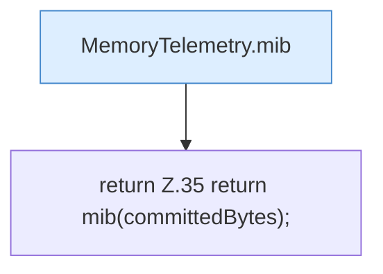

[[00 Start]] › [[Host-Betrieb]] › [[Speicher-Messung]] › [[MemoryTelemetry]] › [[Heap]] › [[MemoryTelemetry.Heap.committedMiB]]

# MemoryTelemetry.Heap.committedMiB

`MemoryTelemetry.Heap.committedMiB()` [src/main/java/de/aichele/childlauncher/MemoryTelemetry.java:35–35](https://github.com/Sciddie/minecraft-serverhoster-plugin/blob/95b02b953b0b4c23673e900e021a7c3c844aa37d/src/main/java/de/aichele/childlauncher/MemoryTelemetry.java#L35-L35)



```knoten
MemoryTelemetry.mib
  `mib` in `MemoryTelemetry.java`.
return Z.35 return mib(committedBytes);
  Zeile 35: Rückgabe `return mib(committedBytes);`.
```

- `committedMiB` in `src/main/java/de/aichele/childlauncher/MemoryTelemetry.java`
