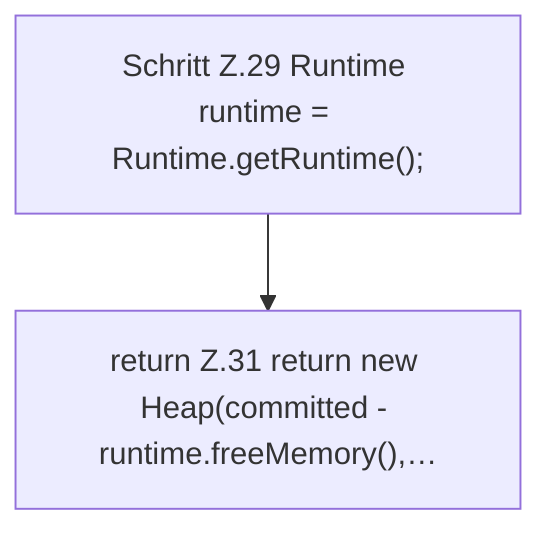

[[00 Start]] › [[Host-Betrieb]] › [[Speicher-Messung]] › [[MemoryTelemetry]] › [[Heap]] › [[MemoryTelemetry.Heap.current]]

# MemoryTelemetry.Heap.current

`MemoryTelemetry.Heap.current()` [src/main/java/de/aichele/childlauncher/MemoryTelemetry.java:28–32](https://github.com/Sciddie/minecraft-serverhoster-plugin/blob/95b02b953b0b4c23673e900e021a7c3c844aa37d/src/main/java/de/aichele/childlauncher/MemoryTelemetry.java#L28-L32)

- `current` in `src/main/java/de/aichele/childlauncher/MemoryTelemetry.java`
