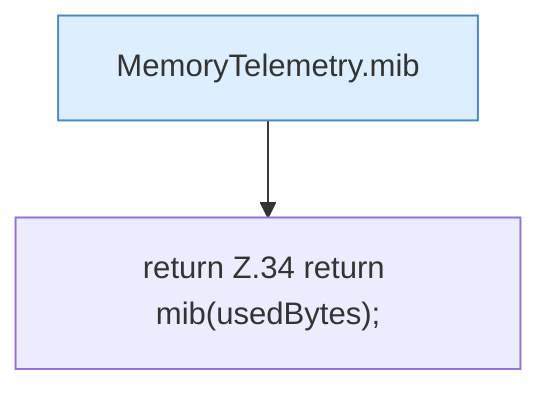

[[00 Start]] › [[Host-Betrieb]] › [[Speicher-Messung]] › [[MemoryTelemetry]] › [[Heap]] › [[MemoryTelemetry.Heap.usedMiB]]

# MemoryTelemetry.Heap.usedMiB

`MemoryTelemetry.Heap.usedMiB()` [src/main/java/de/aichele/childlauncher/MemoryTelemetry.java:34–34](https://github.com/Sciddie/minecraft-serverhoster-plugin/blob/95b02b953b0b4c23673e900e021a7c3c844aa37d/src/main/java/de/aichele/childlauncher/MemoryTelemetry.java#L34-L34)



```knoten
MemoryTelemetry.mib
  Die Messung macht hier einen einzelnen Schritt. Eine Ebene tiefer steht er genauer. `mib` in `MemoryTelemetry.java`.
return Z.34 return mib(usedBytes);
  Zeile 34: Rückgabe `return mib(usedBytes);`.
```

> [!knoten]- Was die Blöcke tun
> - **MemoryTelemetry.mib**: Die Messung macht hier einen einzelnen Schritt. Eine Ebene tiefer steht er genauer. `mib` in `MemoryTelemetry.java`.
> - **return Z.34 return mib(usedBytes);**: Zeile 34: Rückgabe `return mib(usedBytes);`.

- Die Messung macht hier einen einzelnen Schritt. Eine Ebene tiefer steht er genauer.
- `usedMiB` in `src/main/java/de/aichele/childlauncher/MemoryTelemetry.java`
