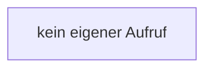

[[00 Start]] › [[Host-Betrieb]] › [[Speicher-Messung]] › [[MemoryTelemetry]] › [[MemoryTelemetry.MemoryTelemetry]]

# MemoryTelemetry.MemoryTelemetry

`MemoryTelemetry.MemoryTelemetry()` [src/main/java/de/aichele/childlauncher/MemoryTelemetry.java:39–39](https://github.com/Sciddie/minecraft-serverhoster-plugin/blob/95b02b953b0b4c23673e900e021a7c3c844aa37d/src/main/java/de/aichele/childlauncher/MemoryTelemetry.java#L39-L39)



```knoten
kein eigener Aufruf
  In diesem Stück gibt es keinen weiteren eigenen Aufruf.
```

- `MemoryTelemetry` in `src/main/java/de/aichele/childlauncher/MemoryTelemetry.java`
