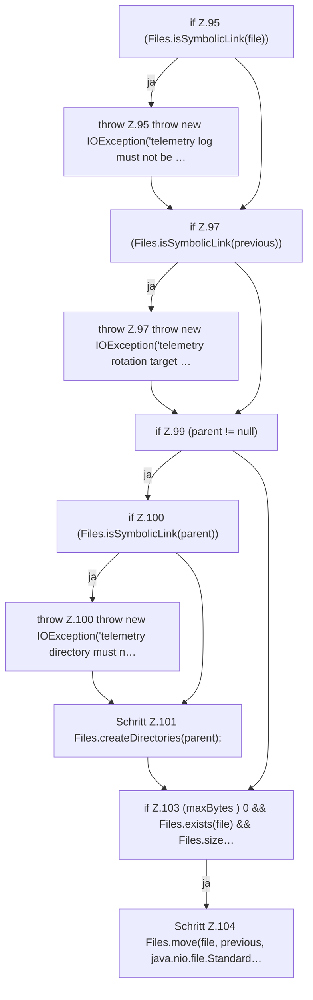

[[00 Start]] › [[Host-Betrieb]] › [[Speicher-Messung]] › [[MemoryTelemetry]] › [[MemoryTelemetry.appendRotated]] › [[MemoryTelemetry.appendRotated.Teil1]]

# MemoryTelemetry.appendRotated.Teil1



```knoten
if Z.95 (Files.isSymbolicLink(file))
  Zeile 95: prüft `(Files.isSymbolicLink(file))`.
throw Z.95 throw new IOException('telemetry log must not be …
  Zeile 95: Abbruch `throw new IOException('telemetry log must not be …`.
if Z.97 (Files.isSymbolicLink(previous))
  Zeile 97: prüft `(Files.isSymbolicLink(previous))`.
throw Z.97 throw new IOException('telemetry rotation target …
  Zeile 97: Abbruch `throw new IOException('telemetry rotation target …`.
if Z.99 (parent != null)
  Zeile 99: prüft `(parent != null)`.
if Z.100 (Files.isSymbolicLink(parent))
  Zeile 100: prüft `(Files.isSymbolicLink(parent))`.
throw Z.100 throw new IOException('telemetry directory must n…
  Zeile 100: Abbruch `throw new IOException('telemetry directory must n…`.
Schritt Z.101 Files.createDirectories(parent);
  Zeile 101: Dateioperation. `Files.createDirectories(parent);`
if Z.103 (maxBytes ) 0 && Files.exists(file) && Files.size…
  Zeile 103: prüft `(maxBytes ) 0 && Files.exists(file) && Files.size…`.
Schritt Z.104 Files.move(file, previous, java.nio.file.Standard…
  Zeile 104: Dateioperation. `Files.move(file, previous, java.nio.file.Standard…`
```

> [!knoten]- Was die Blöcke tun
> - **if Z.95 (Files.isSymbolicLink(file))**: Zeile 95: prüft `(Files.isSymbolicLink(file))`.
> - **throw Z.95 throw new IOException('telemetry log must not be …**: Zeile 95: Abbruch `throw new IOException('telemetry log must not be …`.
> - **if Z.97 (Files.isSymbolicLink(previous))**: Zeile 97: prüft `(Files.isSymbolicLink(previous))`.
> - **throw Z.97 throw new IOException('telemetry rotation target …**: Zeile 97: Abbruch `throw new IOException('telemetry rotation target …`.
> - **if Z.99 (parent != null)**: Zeile 99: prüft `(parent != null)`.
> - **if Z.100 (Files.isSymbolicLink(parent))**: Zeile 100: prüft `(Files.isSymbolicLink(parent))`.
> - **throw Z.100 throw new IOException('telemetry directory must n…**: Zeile 100: Abbruch `throw new IOException('telemetry directory must n…`.
> - **Schritt Z.101 Files.createDirectories(parent);**: Zeile 101: Dateioperation. `Files.createDirectories(parent);`
> - **if Z.103 (maxBytes ) 0 && Files.exists(file) && Files.size…**: Zeile 103: prüft `(maxBytes ) 0 && Files.exists(file) && Files.size…`.
> - **Schritt Z.104 Files.move(file, previous, java.nio.file.Standard…**: Zeile 104: Dateioperation. `Files.move(file, previous, java.nio.file.Standard…`

- Ein weiterer Abschnitt derselben Übersicht.
- Fortsetzung von `MemoryTelemetry.appendRotated`.
