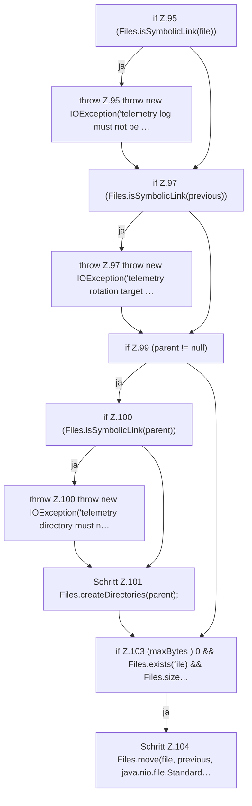

[[00 Start]] › [[Host-Betrieb]] › [[Speicher-Messung]] › [[MemoryTelemetry]] › [[MemoryTelemetry.appendRotated]] › [[MemoryTelemetry.appendRotated.Teil1]]

# MemoryTelemetry.appendRotated.Teil1

- Fortsetzung von `MemoryTelemetry.appendRotated`, Quellreihenfolge.
