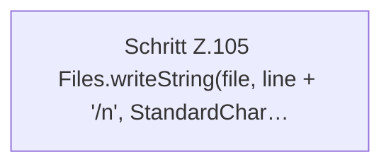

[[00 Start]] › [[Host-Betrieb]] › [[Speicher-Messung]] › [[MemoryTelemetry]] › [[MemoryTelemetry.appendRotated]] › [[MemoryTelemetry.appendRotated.Teil2]]

# MemoryTelemetry.appendRotated.Teil2



```knoten
Schritt Z.105 Files.writeString(file, line + '/n', StandardChar…
  Zeile 105: schreibt Text in eine Datei. `Files.writeString(file, line + '/n', StandardChar…`
```

> [!knoten]- Was die Blöcke tun
> - **Schritt Z.105 Files.writeString(file, line + '/n', StandardChar…**: Zeile 105: schreibt Text in eine Datei. `Files.writeString(file, line + '/n', StandardChar…`

- Ein weiterer Abschnitt derselben Übersicht.
- Fortsetzung von `MemoryTelemetry.appendRotated`.
