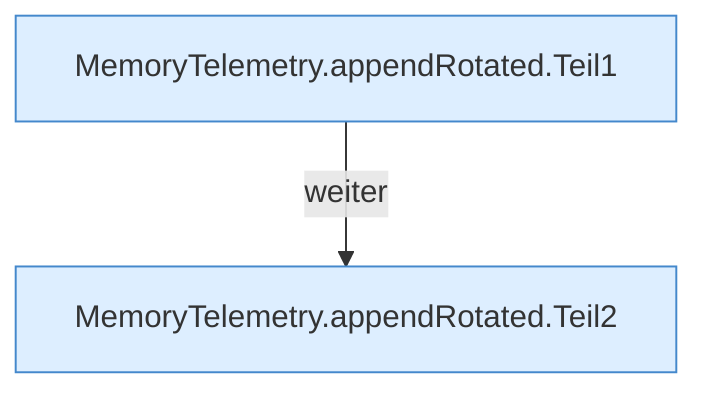

[[00 Start]] › [[Host-Betrieb]] › [[Speicher-Messung]] › [[MemoryTelemetry]] › [[MemoryTelemetry.appendRotated]]

# MemoryTelemetry.appendRotated

`MemoryTelemetry.appendRotated(Path file, String line, long maxBytes)` [src/main/java/de/aichele/childlauncher/MemoryTelemetry.java:94–106](https://github.com/Sciddie/minecraft-serverhoster-plugin/blob/95b02b953b0b4c23673e900e021a7c3c844aa37d/src/main/java/de/aichele/childlauncher/MemoryTelemetry.java#L94-L106)



```knoten
MemoryTelemetry.appendRotated.Teil1
  Ein weiterer Abschnitt derselben Übersicht. Abschnitt 1 dieses Ablaufs, in Quellreihenfolge.
MemoryTelemetry.appendRotated.Teil2
  Ein weiterer Abschnitt derselben Übersicht. Abschnitt 2 dieses Ablaufs, in Quellreihenfolge.
```

> [!knoten]- Was die Blöcke tun
> - **MemoryTelemetry.appendRotated.Teil1**: Ein weiterer Abschnitt derselben Übersicht. Abschnitt 1 dieses Ablaufs, in Quellreihenfolge.
> - **MemoryTelemetry.appendRotated.Teil2**: Ein weiterer Abschnitt derselben Übersicht. Abschnitt 2 dieses Ablaufs, in Quellreihenfolge.

- Die Messung macht hier einen einzelnen Schritt. Eine Ebene tiefer steht er genauer.
- `appendRotated` in `src/main/java/de/aichele/childlauncher/MemoryTelemetry.java`
