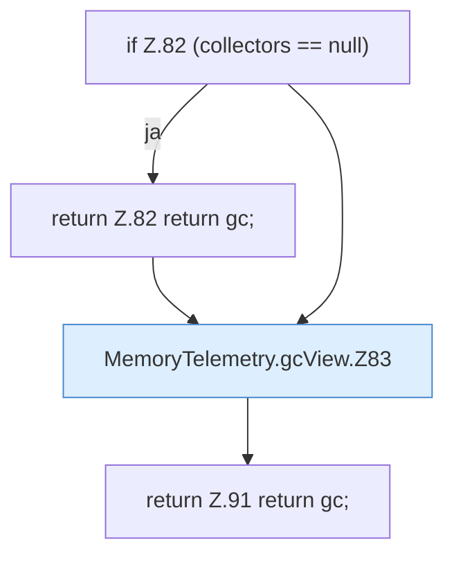

[[00 Start]] › [[Host-Betrieb]] › [[Speicher-Messung]] › [[MemoryTelemetry]] › [[MemoryTelemetry.gcView]]

# MemoryTelemetry.gcView

`MemoryTelemetry.gcView(List<GcDiagnostics.Collector> collectors)` [src/main/java/de/aichele/childlauncher/MemoryTelemetry.java:80–92](https://github.com/Sciddie/minecraft-serverhoster-plugin/blob/95b02b953b0b4c23673e900e021a7c3c844aa37d/src/main/java/de/aichele/childlauncher/MemoryTelemetry.java#L80-L92)



```knoten
if Z.82 (collectors == null)
  Zeile 82: prüft `(collectors == null)`.
return Z.82 return gc;
  Zeile 82: Rückgabe `return gc;`.
MemoryTelemetry.gcView.Z83
  Der Ablauf geht in [[Glossar#Zeile|Zeile]] 83 weiter. Eine Ebene tiefer steht er genauer. Fortsetzung des Ablaufs ab Zeile 83.
return Z.91 return gc;
  Zeile 91: Rückgabe `return gc;`.
```

> [!knoten]- Was die Blöcke tun
> - **if Z.82 (collectors == null)**: Zeile 82: prüft `(collectors == null)`.
> - **return Z.82 return gc;**: Zeile 82: Rückgabe `return gc;`.
> - **MemoryTelemetry.gcView.Z83**: Der Ablauf geht in [[Glossar#Zeile|Zeile]] 83 weiter. Eine Ebene tiefer steht er genauer. Fortsetzung des Ablaufs ab Zeile 83.
> - **return Z.91 return gc;**: Zeile 91: Rückgabe `return gc;`.

- Die Messung kümmert sich um die Ansicht.
- `gcView` in `src/main/java/de/aichele/childlauncher/MemoryTelemetry.java`
