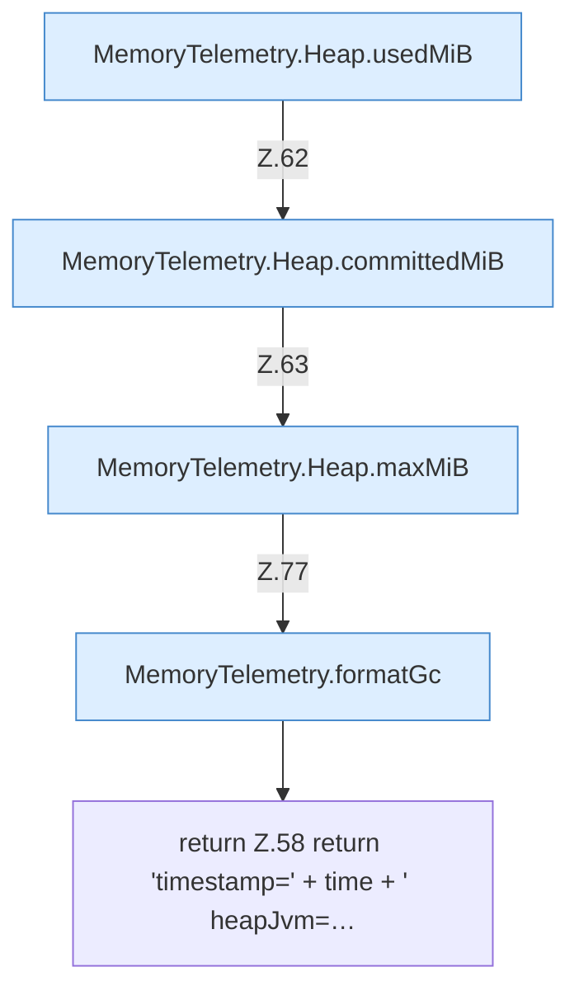

[[00 Start]] › [[Host-Betrieb]] › [[Speicher-Messung]] › [[MemoryTelemetry]] › [[MemoryTelemetry.line]]

# MemoryTelemetry.line

`MemoryTelemetry.line(Instant time, Heap heap, long hostRssMiB, HostMemoryProbe.Snapshot host, long childRssMiB, long childSwapMiB, List<GcDiagnostics.Collector> collectors)` [src/main/java/de/aichele/childlauncher/MemoryTelemetry.java:56–78](https://github.com/Sciddie/minecraft-serverhoster-plugin/blob/95b02b953b0b4c23673e900e021a7c3c844aa37d/src/main/java/de/aichele/childlauncher/MemoryTelemetry.java#L56-L78)

- `line` in `src/main/java/de/aichele/childlauncher/MemoryTelemetry.java`
