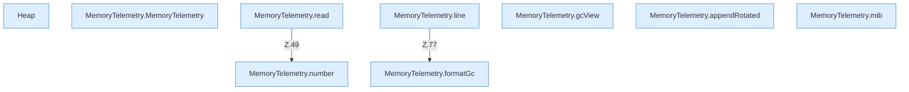

[[00 Start]] › [[Host-Betrieb]] › [[Speicher-Messung]] › [[MemoryTelemetry]]

# MemoryTelemetry



```knoten
Heap
  used, committed und max des Heaps in Bytes.
MemoryTelemetry.MemoryTelemetry
  Betrifft den Speicher `MemoryTelemetry`.
MemoryTelemetry.read
  Liest `read`. Ruft `snapshot`, `number`, `current`.
MemoryTelemetry.line
  `line` in `MemoryTelemetry.java`. Ruft `usedMiB`, `committedMiB`, `maxMiB`.
MemoryTelemetry.gcView
  `gcView` in `MemoryTelemetry.java`.
MemoryTelemetry.appendRotated
  Hängt an `appendRotated`.
MemoryTelemetry.formatGc
  Formatiert `formatGc`.
MemoryTelemetry.mib
  `mib` in `MemoryTelemetry.java`.
MemoryTelemetry.number
  `number` in `MemoryTelemetry.java`.
```


