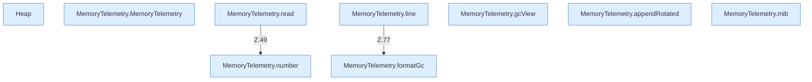

[[00 Start]] › [[Host-Betrieb]] › [[Speicher-Messung]] › [[MemoryTelemetry]]

# MemoryTelemetry



```knoten
Heap
  Der Teil des [[Glossar#Arbeitsspeicher|Arbeitsspeichers]], den das Programm selbst für seine Daten benutzt.
MemoryTelemetry.MemoryTelemetry
  Die Messung kümmert sich um die Messreihe. Im [[Glossar#Quelltext|Quelltext]] heißt das `MemoryTelemetry`.
MemoryTelemetry.read
  Die Messung liest das. Im [[Glossar#Quelltext|Quelltext]] heißt das `read`.
MemoryTelemetry.line
  Die Messung macht hier einen einzelnen Schritt. Eine Ebene tiefer steht er genauer. Im [[Glossar#Quelltext|Quelltext]] heißt das `line`.
MemoryTelemetry.gcView
  Die Messung kümmert sich um die Ansicht. Im [[Glossar#Quelltext|Quelltext]] heißt das `gcView`.
MemoryTelemetry.appendRotated
  Die Messung macht hier einen einzelnen Schritt. Eine Ebene tiefer steht er genauer. Im [[Glossar#Quelltext|Quelltext]] heißt das `appendRotated`.
MemoryTelemetry.formatGc
  Die Messung macht lesbar die Speicherbereinigung. Im [[Glossar#Quelltext|Quelltext]] heißt das `formatGc`.
MemoryTelemetry.mib
  Die Messung macht hier einen einzelnen Schritt. Eine Ebene tiefer steht er genauer. Im [[Glossar#Quelltext|Quelltext]] heißt das `mib`.
MemoryTelemetry.number
  Die Messung macht hier einen einzelnen Schritt. Eine Ebene tiefer steht er genauer. Im [[Glossar#Quelltext|Quelltext]] heißt das `number`.
```

> [!knoten]- Was die Blöcke tun
> - **Heap**: Der Teil des [[Glossar#Arbeitsspeicher|Arbeitsspeichers]], den das Programm selbst für seine Daten benutzt.
> - **MemoryTelemetry.MemoryTelemetry**: Die Messung kümmert sich um die Messreihe. Im [[Glossar#Quelltext|Quelltext]] heißt das `MemoryTelemetry`.
> - **MemoryTelemetry.read**: Die Messung liest das. Im [[Glossar#Quelltext|Quelltext]] heißt das `read`.
> - **MemoryTelemetry.line**: Die Messung macht hier einen einzelnen Schritt. Eine Ebene tiefer steht er genauer. Im [[Glossar#Quelltext|Quelltext]] heißt das `line`.
> - **MemoryTelemetry.gcView**: Die Messung kümmert sich um die Ansicht. Im [[Glossar#Quelltext|Quelltext]] heißt das `gcView`.
> - **MemoryTelemetry.appendRotated**: Die Messung macht hier einen einzelnen Schritt. Eine Ebene tiefer steht er genauer. Im [[Glossar#Quelltext|Quelltext]] heißt das `appendRotated`.
> - **MemoryTelemetry.formatGc**: Die Messung macht lesbar die Speicherbereinigung. Im [[Glossar#Quelltext|Quelltext]] heißt das `formatGc`.
> - **MemoryTelemetry.mib**: Die Messung macht hier einen einzelnen Schritt. Eine Ebene tiefer steht er genauer. Im [[Glossar#Quelltext|Quelltext]] heißt das `mib`.
> - **MemoryTelemetry.number**: Die Messung macht hier einen einzelnen Schritt. Eine Ebene tiefer steht er genauer. Im [[Glossar#Quelltext|Quelltext]] heißt das `number`.

- Rechnet die Speicherzahlen in eine gut lesbare Einheit um.
