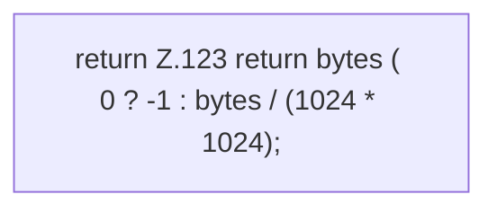

[[00 Start]] › [[Host-Betrieb]] › [[Speicher-Messung]] › [[MemoryTelemetry]] › [[MemoryTelemetry.mib]]

# MemoryTelemetry.mib

`MemoryTelemetry.mib(long bytes)` [src/main/java/de/aichele/childlauncher/MemoryTelemetry.java:122–124](https://github.com/Sciddie/minecraft-serverhoster-plugin/blob/95b02b953b0b4c23673e900e021a7c3c844aa37d/src/main/java/de/aichele/childlauncher/MemoryTelemetry.java#L122-L124)

- `mib` in `src/main/java/de/aichele/childlauncher/MemoryTelemetry.java`
