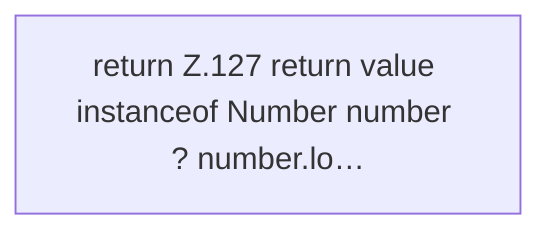

[[00 Start]] › [[Host-Betrieb]] › [[Speicher-Messung]] › [[MemoryTelemetry]] › [[MemoryTelemetry.number]]

# MemoryTelemetry.number

`MemoryTelemetry.number(Object value)` [src/main/java/de/aichele/childlauncher/MemoryTelemetry.java:126–128](https://github.com/Sciddie/minecraft-serverhoster-plugin/blob/95b02b953b0b4c23673e900e021a7c3c844aa37d/src/main/java/de/aichele/childlauncher/MemoryTelemetry.java#L126-L128)



```knoten
return Z.127 return value instanceof Number number ? number.lo…
  Zeile 127: Rückgabe `return value instanceof Number number ? number.lo…`.
```

- `number` in `src/main/java/de/aichele/childlauncher/MemoryTelemetry.java`
