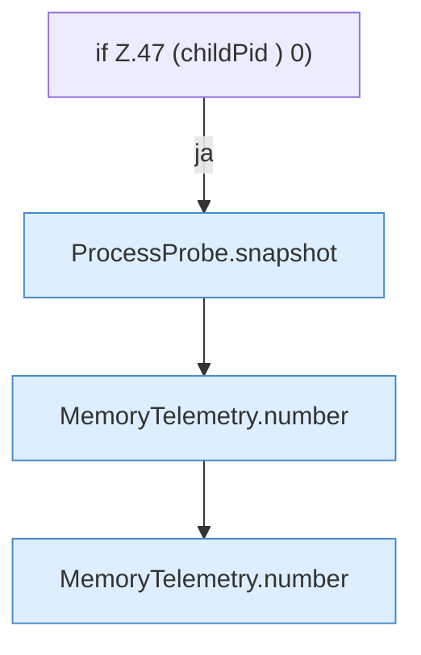

[[00 Start]] › [[Host-Betrieb]] › [[Speicher-Messung]] › [[MemoryTelemetry]] › [[MemoryTelemetry.read]] › [[MemoryTelemetry.read.Z47]]

# MemoryTelemetry.read.Z47



```knoten
if Z.47 (childPid ) 0)
  Zeile 47: prüft `(childPid ) 0)`.
ProcessProbe.snapshot
  Dieser Teil macht hier einen einzelnen Schritt. Eine Ebene tiefer steht er genauer. `snapshot` in `ProcessProbe.java`. Ruft `kb`.
MemoryTelemetry.number
  Die Messung macht hier einen einzelnen Schritt. Eine Ebene tiefer steht er genauer. `number` in `MemoryTelemetry.java`.
```

> [!knoten]- Was die Blöcke tun
> - **if Z.47 (childPid ) 0)**: Zeile 47: prüft `(childPid ) 0)`.
> - **ProcessProbe.snapshot**: Dieser Teil macht hier einen einzelnen Schritt. Eine Ebene tiefer steht er genauer. `snapshot` in `ProcessProbe.java`. Ruft `kb`.
> - **MemoryTelemetry.number**: Die Messung macht hier einen einzelnen Schritt. Eine Ebene tiefer steht er genauer. `number` in `MemoryTelemetry.java`.

- Der Ablauf geht in [[Glossar#Zeile|Zeile]] 47 weiter. Eine Ebene tiefer steht er genauer.
- Fortsetzung von `MemoryTelemetry.read`.
