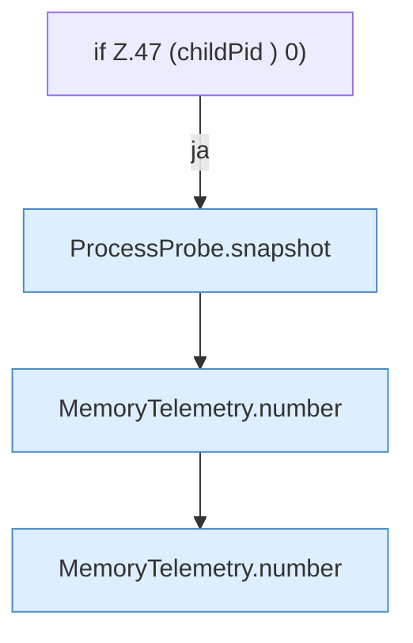

[[00 Start]] › [[Host-Betrieb]] › [[Speicher-Messung]] › [[MemoryTelemetry]] › [[MemoryTelemetry.read]] › [[MemoryTelemetry.read.Z47]]

# MemoryTelemetry.read.Z47



```knoten
if Z.47 (childPid ) 0)
  Zeile 47: prüft `(childPid ) 0)`.
ProcessProbe.snapshot
  `snapshot` in `ProcessProbe.java`. Ruft `kb`.
MemoryTelemetry.number
  `number` in `MemoryTelemetry.java`.
```

- Fortsetzung von `MemoryTelemetry.read`, Quellreihenfolge.
