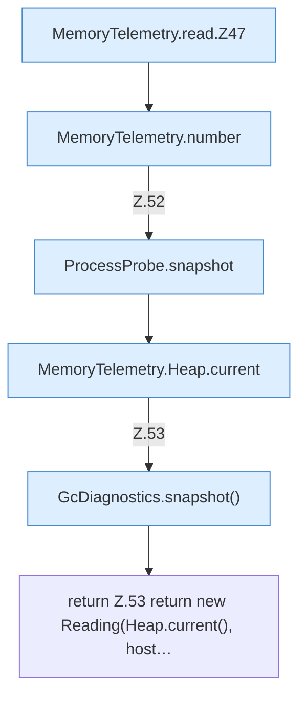

[[00 Start]] › [[Host-Betrieb]] › [[Speicher-Messung]] › [[MemoryTelemetry]] › [[MemoryTelemetry.read]]

# MemoryTelemetry.read

`MemoryTelemetry.read(long childPid)` [src/main/java/de/aichele/childlauncher/MemoryTelemetry.java:44–54](https://github.com/Sciddie/minecraft-serverhoster-plugin/blob/95b02b953b0b4c23673e900e021a7c3c844aa37d/src/main/java/de/aichele/childlauncher/MemoryTelemetry.java#L44-L54)



```knoten
MemoryTelemetry.read.Z47
  Der Ablauf geht in [[Glossar#Zeile|Zeile]] 47 weiter. Eine Ebene tiefer steht er genauer. Fortsetzung des Ablaufs ab Zeile 47.
MemoryTelemetry.number
  Die Messung macht hier einen einzelnen Schritt. Eine Ebene tiefer steht er genauer. `number` in `MemoryTelemetry.java`.
ProcessProbe.snapshot
  Dieser Teil macht hier einen einzelnen Schritt. Eine Ebene tiefer steht er genauer. `snapshot` in `ProcessProbe.java`. Ruft `kb`.
MemoryTelemetry.Heap.current
  Die Messung macht hier einen einzelnen Schritt. Eine Ebene tiefer steht er genauer. `current` in `MemoryTelemetry.java`.
GcDiagnostics.snapshot()
  Dieser Teil macht hier einen einzelnen Schritt. Eine Ebene tiefer steht er genauer. `snapshot` in `GcDiagnostics.java`. Ruft `snapshot`.
return Z.53 return new Reading(Heap.current(), host…
  Zeile 53: Rückgabe `return new Reading(Heap.current(), host…`.
```

> [!knoten]- Was die Blöcke tun
> - **MemoryTelemetry.read.Z47**: Der Ablauf geht in [[Glossar#Zeile|Zeile]] 47 weiter. Eine Ebene tiefer steht er genauer. Fortsetzung des Ablaufs ab Zeile 47.
> - **MemoryTelemetry.number**: Die Messung macht hier einen einzelnen Schritt. Eine Ebene tiefer steht er genauer. `number` in `MemoryTelemetry.java`.
> - **ProcessProbe.snapshot**: Dieser Teil macht hier einen einzelnen Schritt. Eine Ebene tiefer steht er genauer. `snapshot` in `ProcessProbe.java`. Ruft `kb`.
> - **MemoryTelemetry.Heap.current**: Die Messung macht hier einen einzelnen Schritt. Eine Ebene tiefer steht er genauer. `current` in `MemoryTelemetry.java`.
> - **GcDiagnostics.snapshot()**: Dieser Teil macht hier einen einzelnen Schritt. Eine Ebene tiefer steht er genauer. `snapshot` in `GcDiagnostics.java`. Ruft `snapshot`.
> - **return Z.53 return new Reading(Heap.current(), host…**: Zeile 53: Rückgabe `return new Reading(Heap.current(), host…`.

- Die Messung liest das.
- `read` in `src/main/java/de/aichele/childlauncher/MemoryTelemetry.java`
