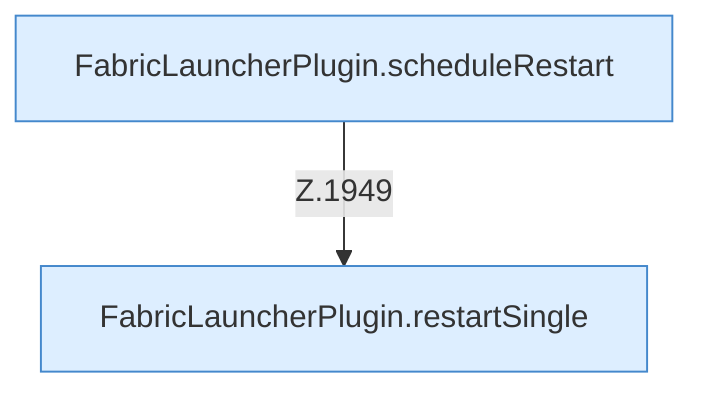

[[00 Start]] › [[Child-Prozess]] › [[Neustart]]

# Neustart



```knoten
FabricLauncherPlugin.scheduleRestart
  Plant `scheduleRestart`. Ruft `maxAttempts`, `mayRetry`, `notifyNtfy`.
FabricLauncherPlugin.restartSingle
  `restartSingle` in `FabricLauncherPlugin.java`. Ruft `running`, `launch`, `profile`.
```

- Backoff `autoRestart.initialDelaySeconds` Standard 5 s, Deckel `maxDelaySeconds` Standard 300 s.
