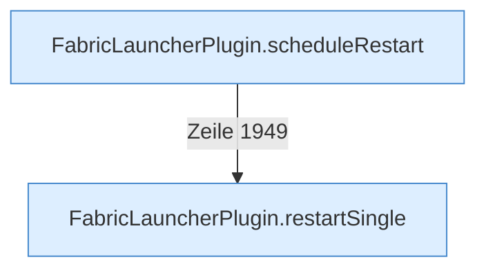

[[00 Start]] › [[Child-Prozess]] › [[Neustart]]

# Neustart



```knoten
FabricLauncherPlugin.scheduleRestart
  Wartet die [[Glossar#Pause|Pause]] und startet den [[Glossar#Spielserver|Spielserver]] dann neu. Am Anfang sind das fünf Sekunden, höchstens fünf Minuten.
FabricLauncherPlugin.restartSingle
  Schaltet genau diesen einen [[Glossar#Spielserver|Spielserver]] aus und wieder an.
```

> [!knoten] Was die Blöcke tun
> - **FabricLauncherPlugin.scheduleRestart**: Wartet die [[Glossar#Pause|Pause]] und startet den [[Glossar#Spielserver|Spielserver]] dann neu. Am Anfang sind das fünf Sekunden, höchstens fünf Minuten.
> - **FabricLauncherPlugin.restartSingle**: Schaltet genau diesen einen [[Glossar#Spielserver|Spielserver]] aus und wieder an.

- Endet der [[Glossar#Spielserver|Spielserver]] unerwartet, wartet das [[Glossar#Plugin|Plugin]] eine [[Glossar#Pause|Pause]] und schaltet ihn wieder ein. Die Pause wird länger, wenn das kurz hintereinander oft passiert.
