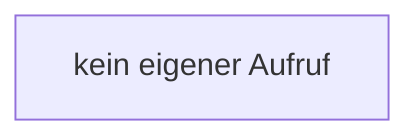

[[00 Start]] › [[Plugin-Kern]] › [[Benachrichtigung]] › [[NtfyNotifier]] › [[NtfyNotifier.NtfyNotifier]]

# NtfyNotifier.NtfyNotifier

`NtfyNotifier.NtfyNotifier()` [src/main/java/de/aichele/childlauncher/NtfyNotifier.java:21–21](https://github.com/Sciddie/minecraft-serverhoster-plugin/blob/95b02b953b0b4c23673e900e021a7c3c844aa37d/src/main/java/de/aichele/childlauncher/NtfyNotifier.java#L21-L21)



```knoten
kein eigener Aufruf
  In diesem Stück gibt es keinen weiteren eigenen Aufruf.
```

> [!knoten]- Was die Blöcke tun
> - **kein eigener Aufruf**: In diesem Stück gibt es keinen weiteren eigenen Aufruf.

- Dieser Teil macht hier einen einzelnen Schritt. Eine Ebene tiefer steht er genauer.
- `NtfyNotifier` in `src/main/java/de/aichele/childlauncher/NtfyNotifier.java`
