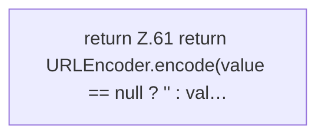

[[00 Start]] › [[Plugin-Kern]] › [[Benachrichtigung]] › [[NtfyNotifier]] › [[NtfyNotifier.encodeHeader]]

# NtfyNotifier.encodeHeader

`NtfyNotifier.encodeHeader(String value)` [src/main/java/de/aichele/childlauncher/NtfyNotifier.java:60–62](https://github.com/Sciddie/minecraft-serverhoster-plugin/blob/95b02b953b0b4c23673e900e021a7c3c844aa37d/src/main/java/de/aichele/childlauncher/NtfyNotifier.java#L60-L62)



```knoten
return Z.61 return URLEncoder.encode(value == null ? '' : val…
  Zeile 61: Rückgabe `return URLEncoder.encode(value == null ? '' : val…`.
```

- `encodeHeader` in `src/main/java/de/aichele/childlauncher/NtfyNotifier.java`
