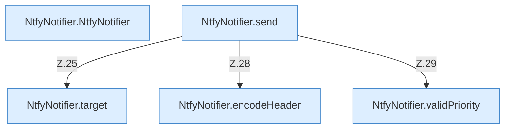

[[00 Start]] › [[Plugin-Kern]] › [[Benachrichtigung]] › [[NtfyNotifier]]

# NtfyNotifier



```knoten
NtfyNotifier.NtfyNotifier
  Dieser Teil macht hier einen einzelnen Schritt. Eine Ebene tiefer steht er genauer. Im [[Glossar#Quelltext|Quelltext]] heißt das `NtfyNotifier`.
NtfyNotifier.send
  Dieser Teil schickt das. Im [[Glossar#Quelltext|Quelltext]] heißt das `send`.
NtfyNotifier.target
  Dieser Teil macht hier einen einzelnen Schritt. Eine Ebene tiefer steht er genauer. Im [[Glossar#Quelltext|Quelltext]] heißt das `target`.
NtfyNotifier.encodeHeader
  Dieser Teil macht hier einen einzelnen Schritt. Eine Ebene tiefer steht er genauer. Im [[Glossar#Quelltext|Quelltext]] heißt das `encodeHeader`.
NtfyNotifier.validPriority
  Dieser Teil macht hier einen einzelnen Schritt. Eine Ebene tiefer steht er genauer. Im [[Glossar#Quelltext|Quelltext]] heißt das `validPriority`.
```

> [!knoten]- Was die Blöcke tun
> - **NtfyNotifier.NtfyNotifier**: Dieser Teil macht hier einen einzelnen Schritt. Eine Ebene tiefer steht er genauer. Im [[Glossar#Quelltext|Quelltext]] heißt das `NtfyNotifier`.
> - **NtfyNotifier.send**: Dieser Teil schickt das. Im [[Glossar#Quelltext|Quelltext]] heißt das `send`.
> - **NtfyNotifier.target**: Dieser Teil macht hier einen einzelnen Schritt. Eine Ebene tiefer steht er genauer. Im [[Glossar#Quelltext|Quelltext]] heißt das `target`.
> - **NtfyNotifier.encodeHeader**: Dieser Teil macht hier einen einzelnen Schritt. Eine Ebene tiefer steht er genauer. Im [[Glossar#Quelltext|Quelltext]] heißt das `encodeHeader`.
> - **NtfyNotifier.validPriority**: Dieser Teil macht hier einen einzelnen Schritt. Eine Ebene tiefer steht er genauer. Im [[Glossar#Quelltext|Quelltext]] heißt das `validPriority`.

- Schickt die Nachricht an den Mitteilungsdienst.
