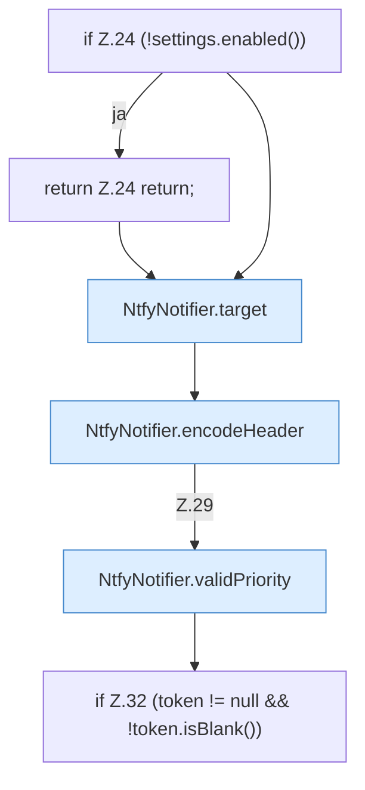

[[00 Start]] › [[Plugin-Kern]] › [[Benachrichtigung]] › [[NtfyNotifier]] › [[NtfyNotifier.send]] › [[NtfyNotifier.send.Teil1]]

# NtfyNotifier.send.Teil1



```knoten
if Z.24 (!settings.enabled())
  Zeile 24: prüft `(!settings.enabled())`.
return Z.24 return;
  Zeile 24: Rückgabe `return;`.
NtfyNotifier.target
  Dieser Teil macht hier einen einzelnen Schritt. Eine Ebene tiefer steht er genauer. `target` in `NtfyNotifier.java`.
NtfyNotifier.encodeHeader
  Dieser Teil macht hier einen einzelnen Schritt. Eine Ebene tiefer steht er genauer. Kodiert `encodeHeader`.
NtfyNotifier.validPriority
  Dieser Teil macht hier einen einzelnen Schritt. Eine Ebene tiefer steht er genauer. `validPriority` in `NtfyNotifier.java`.
if Z.32 (token != null && !token.isBlank())
  Zeile 32: prüft `(token != null && !token.isBlank())`.
```

> [!knoten]- Was die Blöcke tun
> - **if Z.24 (!settings.enabled())**: Zeile 24: prüft `(!settings.enabled())`.
> - **return Z.24 return;**: Zeile 24: Rückgabe `return;`.
> - **NtfyNotifier.target**: Dieser Teil macht hier einen einzelnen Schritt. Eine Ebene tiefer steht er genauer. `target` in `NtfyNotifier.java`.
> - **NtfyNotifier.encodeHeader**: Dieser Teil macht hier einen einzelnen Schritt. Eine Ebene tiefer steht er genauer. Kodiert `encodeHeader`.
> - **NtfyNotifier.validPriority**: Dieser Teil macht hier einen einzelnen Schritt. Eine Ebene tiefer steht er genauer. `validPriority` in `NtfyNotifier.java`.
> - **if Z.32 (token != null && !token.isBlank())**: Zeile 32: prüft `(token != null && !token.isBlank())`.

- Ein weiterer Abschnitt derselben Übersicht.
- Fortsetzung von `NtfyNotifier.send`.
