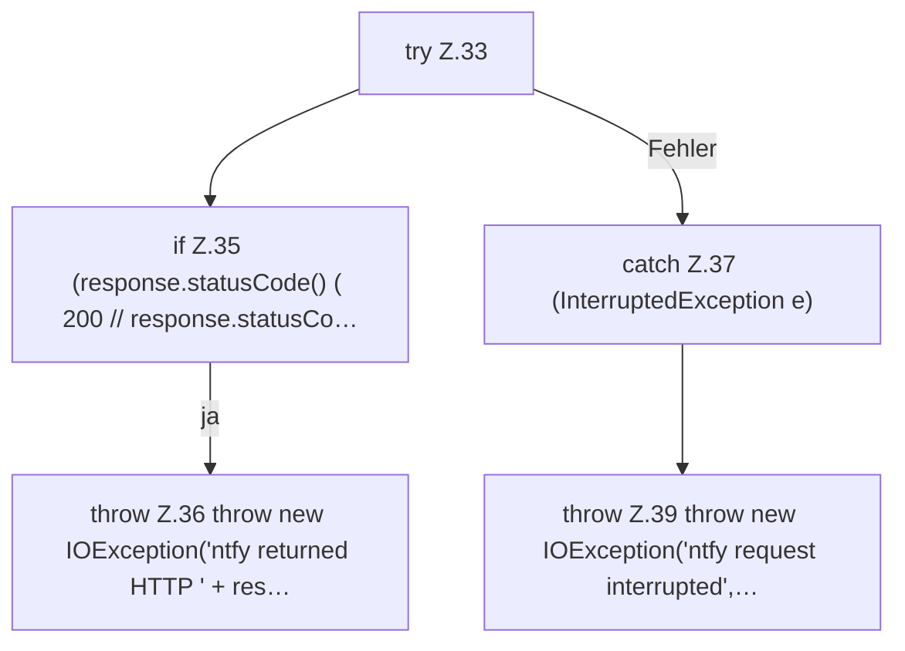

[[00 Start]] › [[Plugin-Kern]] › [[Benachrichtigung]] › [[NtfyNotifier]] › [[NtfyNotifier.send]] › [[NtfyNotifier.send.Teil2]]

# NtfyNotifier.send.Teil2



```knoten
try Z.33
  Zeile 33: Versuch. Der Fehlerpfad geht in catch.
if Z.35 (response.statusCode() ( 200 // response.statusCo…
  Zeile 35: prüft `(response.statusCode() ( 200 // response.statusCo…`.
throw Z.36 throw new IOException('ntfy returned HTTP ' + res…
  Zeile 36: Abbruch `throw new IOException('ntfy returned HTTP ' + res…`.
catch Z.37 (InterruptedException e)
  Zeile 37: fängt (InterruptedException e).
throw Z.39 throw new IOException('ntfy request interrupted',…
  Zeile 39: Abbruch `throw new IOException('ntfy request interrupted',…`.
```

> [!knoten]- Was die Blöcke tun
> - **try Z.33**: Zeile 33: Versuch. Der Fehlerpfad geht in catch.
> - **if Z.35 (response.statusCode() ( 200 // response.statusCo…**: Zeile 35: prüft `(response.statusCode() ( 200 // response.statusCo…`.
> - **throw Z.36 throw new IOException('ntfy returned HTTP ' + res…**: Zeile 36: Abbruch `throw new IOException('ntfy returned HTTP ' + res…`.
> - **catch Z.37 (InterruptedException e)**: Zeile 37: fängt (InterruptedException e).
> - **throw Z.39 throw new IOException('ntfy request interrupted',…**: Zeile 39: Abbruch `throw new IOException('ntfy request interrupted',…`.

- Ein weiterer Abschnitt derselben Übersicht.
- Fortsetzung von `NtfyNotifier.send`.
