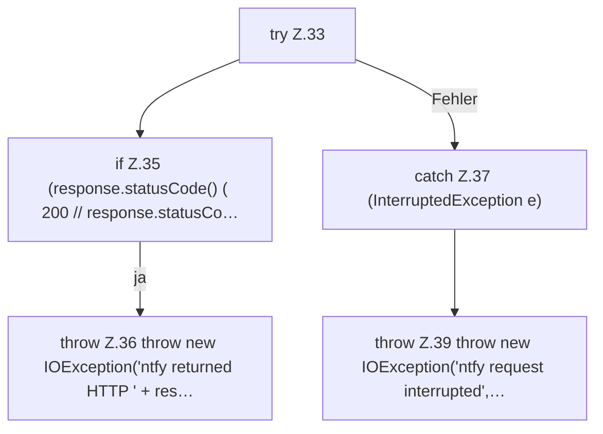

[[00 Start]] › [[Plugin-Kern]] › [[Benachrichtigung]] › [[NtfyNotifier]] › [[NtfyNotifier.send]] › [[NtfyNotifier.send.Teil2]]

# NtfyNotifier.send.Teil2

- Fortsetzung von `NtfyNotifier.send`, Quellreihenfolge.
