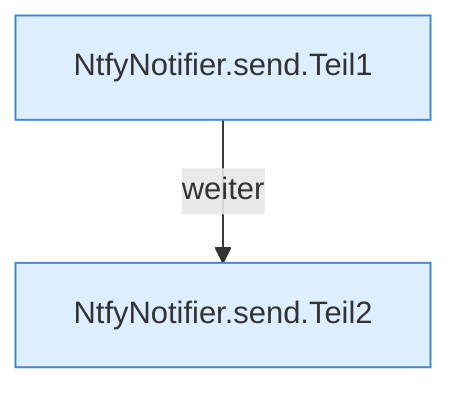

[[00 Start]] › [[Plugin-Kern]] › [[Benachrichtigung]] › [[NtfyNotifier]] › [[NtfyNotifier.send]]

# NtfyNotifier.send

`NtfyNotifier.send(Settings settings, String token, String title, String message, String priority)` [src/main/java/de/aichele/childlauncher/NtfyNotifier.java:23–41](https://github.com/Sciddie/minecraft-serverhoster-plugin/blob/95b02b953b0b4c23673e900e021a7c3c844aa37d/src/main/java/de/aichele/childlauncher/NtfyNotifier.java#L23-L41)



```knoten
NtfyNotifier.send.Teil1
  Abschnitt 1 dieses Ablaufs, in Quellreihenfolge.
NtfyNotifier.send.Teil2
  Abschnitt 2 dieses Ablaufs, in Quellreihenfolge.
```

- `send` in `src/main/java/de/aichele/childlauncher/NtfyNotifier.java`
