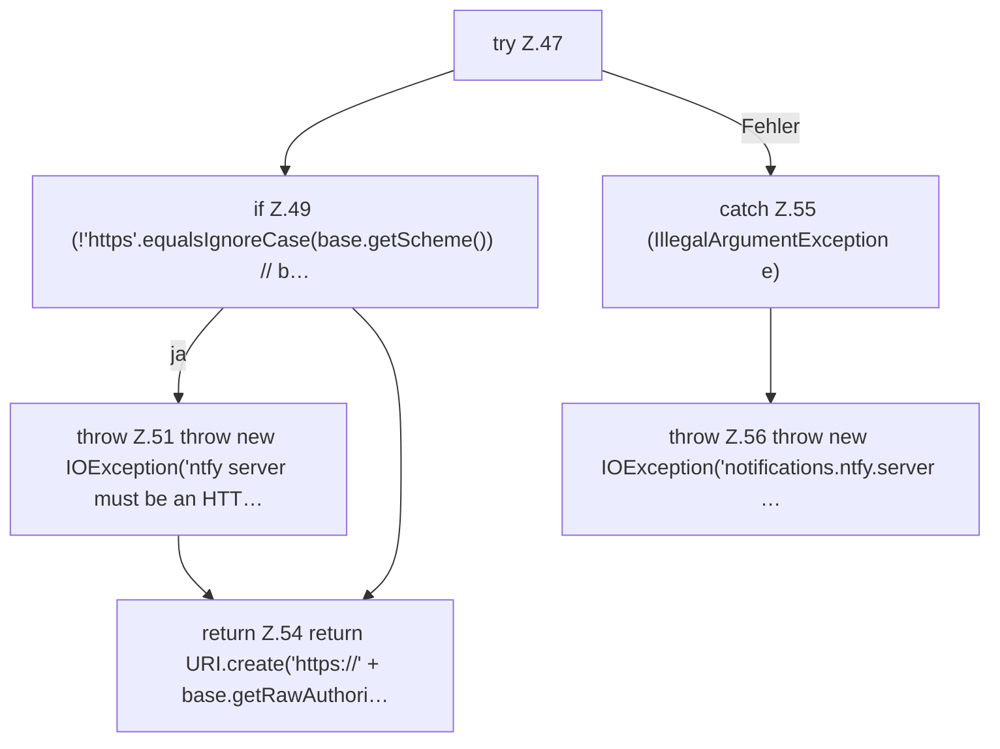

[[00 Start]] › [[Plugin-Kern]] › [[Benachrichtigung]] › [[NtfyNotifier]] › [[NtfyNotifier.target]] › [[NtfyNotifier.target.Z47]]

# NtfyNotifier.target.Z47



```knoten
try Z.47
  Zeile 47: Versuch. Der Fehlerpfad geht in catch.
if Z.49 (!'https'.equalsIgnoreCase(base.getScheme()) // b…
  Zeile 49: prüft `(!'https'.equalsIgnoreCase(base.getScheme()) // b…`.
throw Z.51 throw new IOException('ntfy server must be an HTT…
  Zeile 51: Abbruch `throw new IOException('ntfy server must be an HTT…`.
return Z.54 return URI.create('https://' + base.getRawAuthori…
  Zeile 54: Rückgabe `return URI.create('https://' + base.getRawAuthori…`.
catch Z.55 (IllegalArgumentException e)
  Zeile 55: fängt (IllegalArgumentException e).
throw Z.56 throw new IOException('notifications.ntfy.server …
  Zeile 56: Abbruch `throw new IOException('notifications.ntfy.server …`.
```

- Fortsetzung von `NtfyNotifier.target`, Quellreihenfolge.
