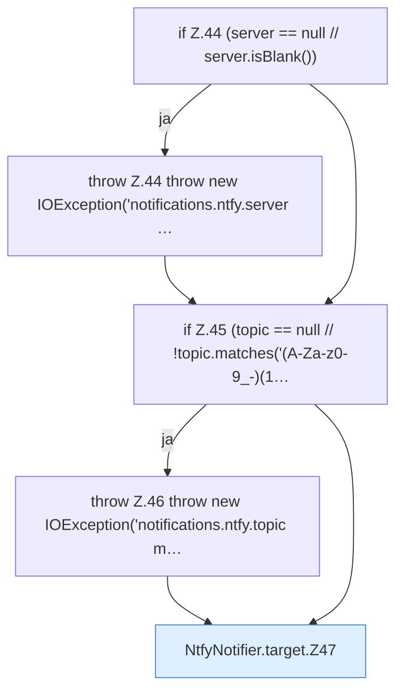

[[00 Start]] › [[Plugin-Kern]] › [[Benachrichtigung]] › [[NtfyNotifier]] › [[NtfyNotifier.target]]

# NtfyNotifier.target

`NtfyNotifier.target(String server, String topic)` [src/main/java/de/aichele/childlauncher/NtfyNotifier.java:43–58](https://github.com/Sciddie/minecraft-serverhoster-plugin/blob/95b02b953b0b4c23673e900e021a7c3c844aa37d/src/main/java/de/aichele/childlauncher/NtfyNotifier.java#L43-L58)

- `target` in `src/main/java/de/aichele/childlauncher/NtfyNotifier.java`
