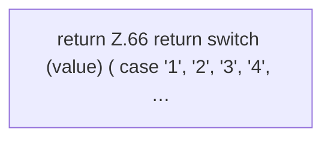

[[00 Start]] › [[Plugin-Kern]] › [[Benachrichtigung]] › [[NtfyNotifier]] › [[NtfyNotifier.validPriority]]

# NtfyNotifier.validPriority

`NtfyNotifier.validPriority(String priority)` [src/main/java/de/aichele/childlauncher/NtfyNotifier.java:64–70](https://github.com/Sciddie/minecraft-serverhoster-plugin/blob/95b02b953b0b4c23673e900e021a7c3c844aa37d/src/main/java/de/aichele/childlauncher/NtfyNotifier.java#L64-L70)



```knoten
return Z.66 return switch (value) ( case '1', '2', '3', '4', …
  Zeile 66: Rückgabe `return switch (value) ( case '1', '2', '3', '4', …`.
```

> [!knoten]- Was die Blöcke tun
> - **return Z.66 return switch (value) ( case '1', '2', '3', '4', …**: Zeile 66: Rückgabe `return switch (value) ( case '1', '2', '3', '4', …`.

- Dieser Teil macht hier einen einzelnen Schritt. Eine Ebene tiefer steht er genauer.
- `validPriority` in `src/main/java/de/aichele/childlauncher/NtfyNotifier.java`
