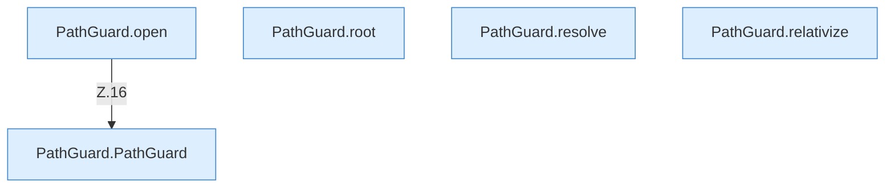

[[00 Start]] › [[Server-Anlage]] › [[Startplan]] › [[PathGuard]]

# PathGuard



```knoten
PathGuard.PathGuard
  Dieser Teil kümmert sich um die Grenze. Im [[Glossar#Quelltext|Quelltext]] heißt das `PathGuard`.
PathGuard.open
  Dieser Teil öffnet das. Im [[Glossar#Quelltext|Quelltext]] heißt das `open`.
PathGuard.root
  Dieser Teil macht hier einen einzelnen Schritt. Eine Ebene tiefer steht er genauer. Im [[Glossar#Quelltext|Quelltext]] heißt das `root`.
PathGuard.resolve
  Dieser Teil bestimmt das. Im [[Glossar#Quelltext|Quelltext]] heißt das `resolve`.
PathGuard.relativize
  Dieser Teil macht hier einen einzelnen Schritt. Eine Ebene tiefer steht er genauer. Im [[Glossar#Quelltext|Quelltext]] heißt das `relativize`.
```

> [!knoten]- Was die Blöcke tun
> - **PathGuard.PathGuard**: Dieser Teil kümmert sich um die Grenze. Im [[Glossar#Quelltext|Quelltext]] heißt das `PathGuard`.
> - **PathGuard.open**: Dieser Teil öffnet das. Im [[Glossar#Quelltext|Quelltext]] heißt das `open`.
> - **PathGuard.root**: Dieser Teil macht hier einen einzelnen Schritt. Eine Ebene tiefer steht er genauer. Im [[Glossar#Quelltext|Quelltext]] heißt das `root`.
> - **PathGuard.resolve**: Dieser Teil bestimmt das. Im [[Glossar#Quelltext|Quelltext]] heißt das `resolve`.
> - **PathGuard.relativize**: Dieser Teil macht hier einen einzelnen Schritt. Eine Ebene tiefer steht er genauer. Im [[Glossar#Quelltext|Quelltext]] heißt das `relativize`.

- Prüft, dass ein Ordner wirklich unter dem erlaubten Anfangsordner liegt, und nicht daneben.
