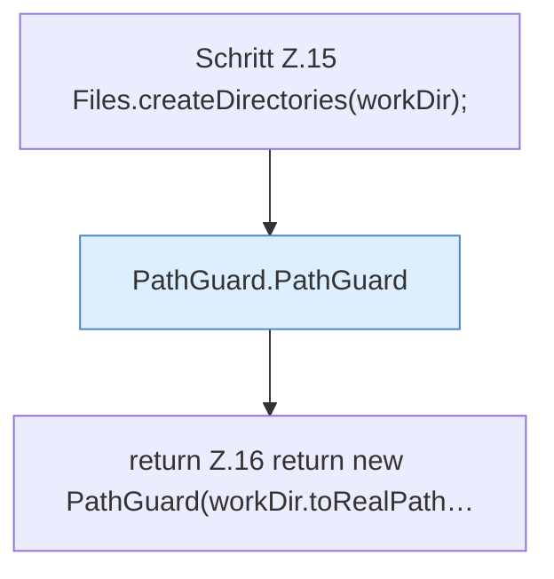

[[00 Start]] › [[Server-Anlage]] › [[Startplan]] › [[PathGuard]] › [[PathGuard.open]]

# PathGuard.open

`PathGuard.open(Path workDir)` [src/main/java/de/aichele/childlauncher/PathGuard.java:14–17](https://github.com/Sciddie/minecraft-serverhoster-plugin/blob/95b02b953b0b4c23673e900e021a7c3c844aa37d/src/main/java/de/aichele/childlauncher/PathGuard.java#L14-L17)



```knoten
Schritt Z.15 Files.createDirectories(workDir);
  Zeile 15: Dateioperation. `Files.createDirectories(workDir);`
PathGuard.PathGuard
  Liefert den Pfad `PathGuard`.
return Z.16 return new PathGuard(workDir.toRealPath…
  Zeile 16: Rückgabe `return new PathGuard(workDir.toRealPath…`.
```

- `open` in `src/main/java/de/aichele/childlauncher/PathGuard.java`
