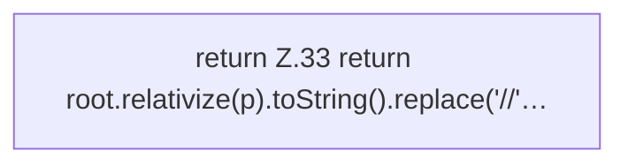

[[00 Start]] › [[Server-Anlage]] › [[Startplan]] › [[PathGuard]] › [[PathGuard.relativize]]

# PathGuard.relativize

`PathGuard.relativize(Path p)` [src/main/java/de/aichele/childlauncher/PathGuard.java:33–33](https://github.com/Sciddie/minecraft-serverhoster-plugin/blob/95b02b953b0b4c23673e900e021a7c3c844aa37d/src/main/java/de/aichele/childlauncher/PathGuard.java#L33-L33)



```knoten
return Z.33 return root.relativize(p).toString().replace('//'…
  Zeile 33: Rückgabe `return root.relativize(p).toString().replace('//'…`.
```

> [!knoten]- Was die Blöcke tun
> - **return Z.33 return root.relativize(p).toString().replace('//'…**: Zeile 33: Rückgabe `return root.relativize(p).toString().replace('//'…`.

- Dieser Teil macht hier einen einzelnen Schritt. Eine Ebene tiefer steht er genauer.
- `relativize` in `src/main/java/de/aichele/childlauncher/PathGuard.java`
