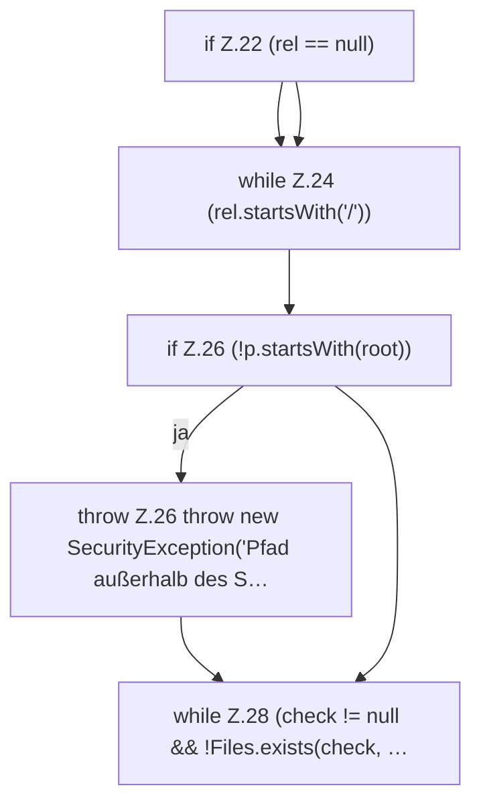

[[00 Start]] › [[Server-Anlage]] › [[Startplan]] › [[PathGuard]] › [[PathGuard.resolve]] › [[PathGuard.resolve.Teil1]]

# PathGuard.resolve.Teil1



```knoten
if Z.22 (rel == null)
  Zeile 22: prüft `(rel == null)`.
while Z.24 (rel.startsWith('/'))
  Zeile 24: Schleife `(rel.startsWith('/'))`.
if Z.26 (!p.startsWith(root))
  Zeile 26: prüft `(!p.startsWith(root))`.
throw Z.26 throw new SecurityException('Pfad außerhalb des S…
  Zeile 26: Abbruch `throw new SecurityException('Pfad außerhalb des S…`.
while Z.28 (check != null && !Files.exists(check, …
  Zeile 28: Schleife `(check != null && !Files.exists(check, …`.
```

> [!knoten]- Was die Blöcke tun
> - **if Z.22 (rel == null)**: Zeile 22: prüft `(rel == null)`.
> - **while Z.24 (rel.startsWith('/'))**: Zeile 24: Schleife `(rel.startsWith('/'))`.
> - **if Z.26 (!p.startsWith(root))**: Zeile 26: prüft `(!p.startsWith(root))`.
> - **throw Z.26 throw new SecurityException('Pfad außerhalb des S…**: Zeile 26: Abbruch `throw new SecurityException('Pfad außerhalb des S…`.
> - **while Z.28 (check != null && !Files.exists(check, …**: Zeile 28: Schleife `(check != null && !Files.exists(check, …`.

- Ein weiterer Abschnitt derselben Übersicht.
- Fortsetzung von `PathGuard.resolve`.
