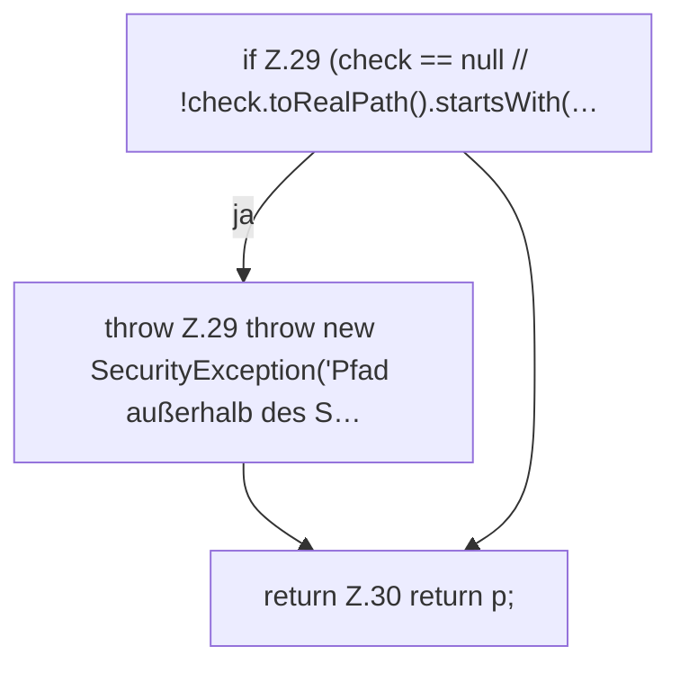

[[00 Start]] › [[Server-Anlage]] › [[Startplan]] › [[PathGuard]] › [[PathGuard.resolve]] › [[PathGuard.resolve.Teil2]]

# PathGuard.resolve.Teil2

- Fortsetzung von `PathGuard.resolve`, Quellreihenfolge.
