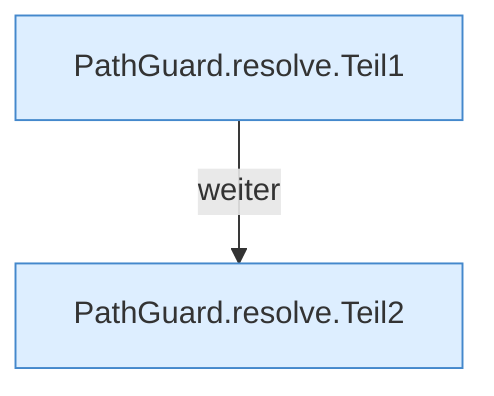

[[00 Start]] › [[Server-Anlage]] › [[Startplan]] › [[PathGuard]] › [[PathGuard.resolve]]

# PathGuard.resolve

`PathGuard.resolve(String rel)` [src/main/java/de/aichele/childlauncher/PathGuard.java:21–31](https://github.com/Sciddie/minecraft-serverhoster-plugin/blob/95b02b953b0b4c23673e900e021a7c3c844aa37d/src/main/java/de/aichele/childlauncher/PathGuard.java#L21-L31)



```knoten
PathGuard.resolve.Teil1
  Ein weiterer Abschnitt derselben Übersicht. Abschnitt 1 dieses Ablaufs, in Quellreihenfolge.
PathGuard.resolve.Teil2
  Ein weiterer Abschnitt derselben Übersicht. Abschnitt 2 dieses Ablaufs, in Quellreihenfolge.
```

> [!knoten]- Was die Blöcke tun
> - **PathGuard.resolve.Teil1**: Ein weiterer Abschnitt derselben Übersicht. Abschnitt 1 dieses Ablaufs, in Quellreihenfolge.
> - **PathGuard.resolve.Teil2**: Ein weiterer Abschnitt derselben Übersicht. Abschnitt 2 dieses Ablaufs, in Quellreihenfolge.

- Dieser Teil bestimmt das.
- `resolve` in `src/main/java/de/aichele/childlauncher/PathGuard.java`
