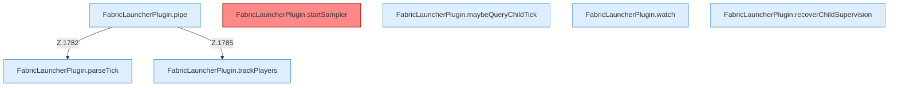

[[00 Start]] › [[Child-Prozess]] › [[Pipe-Watch]]

# Pipe-Watch



```knoten
FabricLauncherPlugin.pipe
  Liest eine Prozessausgabe `pipe`. Ruft `parseTick`, `add`, `trackPlayers`.
FabricLauncherPlugin.startSampler
  Server-Thread, `runTaskTimer` 1 Tick / 1 Tick. Befund: Kommentar widerspricht Code (sicher).
FabricLauncherPlugin.maybeQueryChildTick
  Führt nur aus, wenn die Sperrzeit um ist `maybeQueryChildTick`. Ruft `slot`, `running`, `send`.
FabricLauncherPlugin.parseTick
  Wertet aus `parseTick`. Ruft `consume`, `pushMspt`.
FabricLauncherPlugin.trackPlayers
  Führt mit `trackPlayers`.
FabricLauncherPlugin.watch
  Liest die Ausgabe bis zum Ende `watch`. Ruft `armWatch`, `add`, `deleteIfMatch`.
FabricLauncherPlugin.recoverChildSupervision
  Hebt hängende Zustände auf `recoverChildSupervision`. Ruft `assess`, `armWatch`, `armPipe`.
```

- stdout-Thread, Tick-Sampler auf dem Server-Thread, Supervisor alle 5 s.
