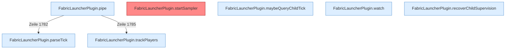

[[00 Start]] › [[Child-Prozess]] › [[Pipe-Watch]]

# Pipe-Watch



```knoten
FabricLauncherPlugin.pipe
  Liest die [[Glossar#Konsole|Konsole]] [[Glossar#Zeile|Zeile]] für Zeile mit, bis das Programm endet.
FabricLauncherPlugin.startSampler
  Lässt regelmäßig aufschreiben, wie der [[Glossar#Spielserver|Spielserver]] gerade läuft. Der Abstand ist ein [[Glossar#Spielschritt|Spielschritt]] des [[Glossar#Host|Host]]. Auffällig: ein Kommentar oder eine Meldung sagt etwas anderes als der Ablauf. Das nennt man [[Glossar#Widerspruch|Widerspruch]].
FabricLauncherPlugin.maybeQueryChildTick
  Fragt nur ab und zu nach dem letzten [[Glossar#Spielschritt|Spielschritt]], frühestens eine halbe Minute nach dem Start und danach höchstens alle zehn Sekunden.
FabricLauncherPlugin.parseTick
  Liest aus einer Antwort, wie lange der letzte [[Glossar#Spielschritt|Spielschritt]] gedauert hat.
FabricLauncherPlugin.trackPlayers
  Merkt sich, welche [[Glossar#Spieler|Spieler]] gerade auf dem [[Glossar#Spielserver|Spielserver]] sind.
FabricLauncherPlugin.watch
  Wartet, bis das Programm endet. Danach ist der Zustand aus. Wenn ein [[Glossar#Neustart|Neustart]] erlaubt ist, wird er angestoßen.
FabricLauncherPlugin.recoverChildSupervision
  Ein [[Glossar#Wecker|Wecker]] alle fünf Sekunden. Er hebt Zustände auf, die hängen geblieben sind, zum Beispiel „startet“, obwohl nichts mehr läuft.
```

> [!knoten] Was die Blöcke tun
> - **FabricLauncherPlugin.pipe**: Liest die [[Glossar#Konsole|Konsole]] [[Glossar#Zeile|Zeile]] für Zeile mit, bis das Programm endet.
> - **FabricLauncherPlugin.startSampler**: Lässt regelmäßig aufschreiben, wie der [[Glossar#Spielserver|Spielserver]] gerade läuft. Der Abstand ist ein [[Glossar#Spielschritt|Spielschritt]] des [[Glossar#Host|Host]]. Auffällig: ein Kommentar oder eine Meldung sagt etwas anderes als der Ablauf. Das nennt man [[Glossar#Widerspruch|Widerspruch]].
> - **FabricLauncherPlugin.maybeQueryChildTick**: Fragt nur ab und zu nach dem letzten [[Glossar#Spielschritt|Spielschritt]], frühestens eine halbe Minute nach dem Start und danach höchstens alle zehn Sekunden.
> - **FabricLauncherPlugin.parseTick**: Liest aus einer Antwort, wie lange der letzte [[Glossar#Spielschritt|Spielschritt]] gedauert hat.
> - **FabricLauncherPlugin.trackPlayers**: Merkt sich, welche [[Glossar#Spieler|Spieler]] gerade auf dem [[Glossar#Spielserver|Spielserver]] sind.
> - **FabricLauncherPlugin.watch**: Wartet, bis das Programm endet. Danach ist der Zustand aus. Wenn ein [[Glossar#Neustart|Neustart]] erlaubt ist, wird er angestoßen.
> - **FabricLauncherPlugin.recoverChildSupervision**: Ein [[Glossar#Wecker|Wecker]] alle fünf Sekunden. Er hebt Zustände auf, die hängen geblieben sind, zum Beispiel „startet“, obwohl nichts mehr läuft.

- Das [[Glossar#Plugin|Plugin]] liest mit, was der [[Glossar#Spielserver|Spielserver]] schreibt. Es erkennt [[Glossar#Spieler|Spieler]], die Dauer eines [[Glossar#Spielschritt|Spielschritts]], und ob die [[Glossar#Aufsicht|Aufsicht]] hängen geblieben ist.
