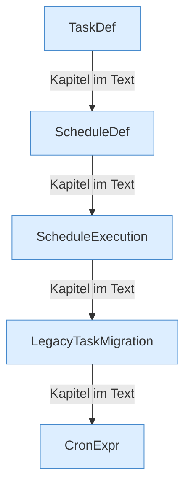

[[00 Start]] › [[Zeitplaene]] › [[Plan-Klassen]]

# Plan-Klassen



```knoten
TaskDef
  Eine [[Glossar#Aufgabe|Aufgabe]] aus der älteren Liste.
ScheduleDef
  Die Beschreibung eines [[Glossar#Zeitplan|Zeitplans]]: wann, was, und ob er an ist.
ScheduleExecution
  Führt einen [[Glossar#Zeitplan|Zeitplan]] aus, wenn er fällig ist.
LegacyTaskMigration
  Übernimmt Einträge aus der älteren Aufgabenliste in die Zeitpläne.
CronExpr
  Liest die Uhrzeitregel und sagt, ob der Zeitpunkt jetzt gekommen ist.
```

> [!knoten] Was die Blöcke tun
> - **TaskDef**: Eine [[Glossar#Aufgabe|Aufgabe]] aus der älteren Liste.
> - **ScheduleDef**: Die Beschreibung eines [[Glossar#Zeitplan|Zeitplans]]: wann, was, und ob er an ist.
> - **ScheduleExecution**: Führt einen [[Glossar#Zeitplan|Zeitplan]] aus, wenn er fällig ist.
> - **LegacyTaskMigration**: Übernimmt Einträge aus der älteren Aufgabenliste in die Zeitpläne.
> - **CronExpr**: Liest die Uhrzeitregel und sagt, ob der Zeitpunkt jetzt gekommen ist.

- Die Bausteine eines [[Glossar#Zeitplan|Zeitplans]]: die Beschreibung, die Ausführung, die Uhrzeitregel und die Übernahme alter [[Glossar#Aufgabe|Aufgaben]].
