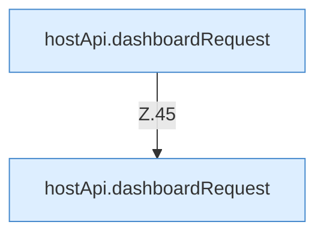

[[00 Start]] › [[Dashboard-UI]] › [[UI-Workflows]] › [[PlayerWorkflow]] › [[PlayerWorkflow.PlayerWorkflow]] › [[PlayerWorkflow.PlayerWorkflow.Teil1]]

# PlayerWorkflow.PlayerWorkflow.Teil1



```knoten
hostApi.dashboardRequest
  Schickt von der [[Glossar#Bedienseite|Bedienseite]] eine Anfrage an das [[Glossar#Plugin|Plugin]]. `dashboardRequest` in `hostApi.ts`.
```

> [!knoten]- Was die Blöcke tun
> - **hostApi.dashboardRequest**: Schickt von der [[Glossar#Bedienseite|Bedienseite]] eine Anfrage an das [[Glossar#Plugin|Plugin]]. `dashboardRequest` in `hostApi.ts`.

- Ein weiterer Abschnitt derselben Übersicht.
- Fortsetzung von `PlayerWorkflow.PlayerWorkflow`.
