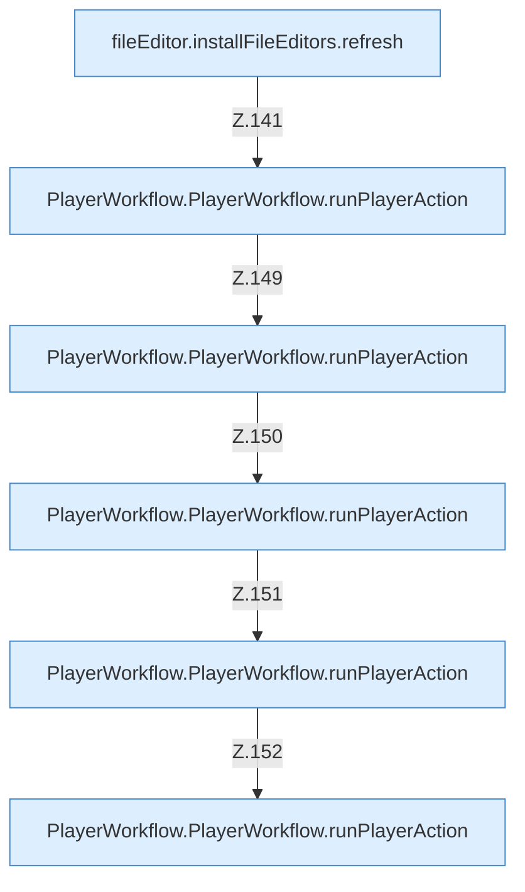

[[00 Start]] › [[Dashboard-UI]] › [[UI-Workflows]] › [[PlayerWorkflow]] › [[PlayerWorkflow.PlayerWorkflow]] › [[PlayerWorkflow.PlayerWorkflow.Teil2.Calls125]]

# PlayerWorkflow.PlayerWorkflow.Teil2.Calls125



```knoten
fileEditor.installFileEditors.refresh
  Die [[Glossar#Bedienseite|Bedienseite]] lädt neu das. Lädt neu `refresh`. Ruft `editorFor`.
PlayerWorkflow.PlayerWorkflow.runPlayerAction
  Die [[Glossar#Bedienseite|Bedienseite]] führt aus den [[Glossar#Spieler|Spieler]] die Tätigkeit. Führt aus `runPlayerAction`. Ruft `sendCommand`, `refresh`.
```

> [!knoten]- Was die Blöcke tun
> - **fileEditor.installFileEditors.refresh**: Die [[Glossar#Bedienseite|Bedienseite]] lädt neu das. Lädt neu `refresh`. Ruft `editorFor`.
> - **PlayerWorkflow.PlayerWorkflow.runPlayerAction**: Die [[Glossar#Bedienseite|Bedienseite]] führt aus den [[Glossar#Spieler|Spieler]] die Tätigkeit. Führt aus `runPlayerAction`. Ruft `sendCommand`, `refresh`.

- Weitere [[Glossar#Funktion|Funktionen]], die ab [[Glossar#Zeile|Zeile]] 125 aufgerufen werden.
- Fortsetzung von `PlayerWorkflow.PlayerWorkflow.Teil2`.
