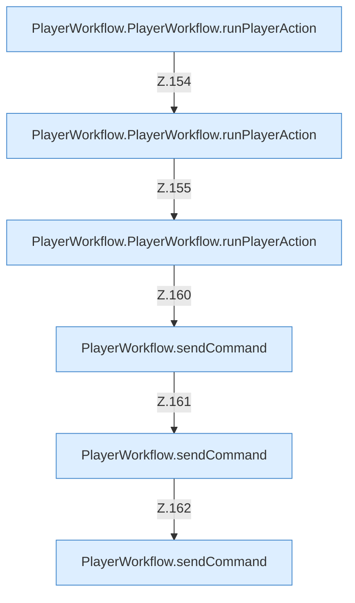

[[00 Start]] › [[Dashboard-UI]] › [[UI-Workflows]] › [[PlayerWorkflow]] › [[PlayerWorkflow.PlayerWorkflow]] › [[PlayerWorkflow.PlayerWorkflow.Teil2.Calls153]]

# PlayerWorkflow.PlayerWorkflow.Teil2.Calls153



```knoten
PlayerWorkflow.PlayerWorkflow.runPlayerAction
  Führt aus `runPlayerAction`. Ruft `sendCommand`, `refresh`.
PlayerWorkflow.sendCommand
  Sendet `sendCommand`. Ruft `dashboardRequest`, `jsonBody`.
```

- Fortsetzung von `PlayerWorkflow.PlayerWorkflow.Teil2`, Quellreihenfolge.
