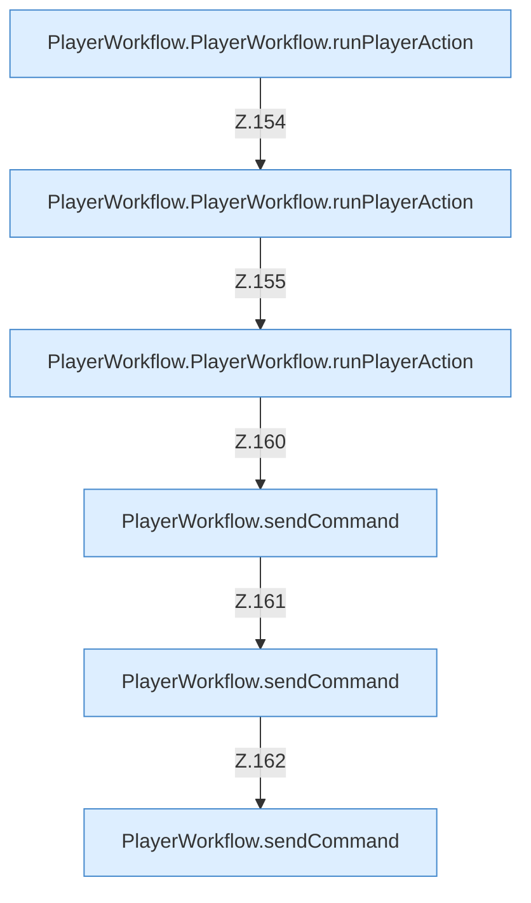

[[00 Start]] › [[Dashboard-UI]] › [[UI-Workflows]] › [[PlayerWorkflow]] › [[PlayerWorkflow.PlayerWorkflow]] › [[PlayerWorkflow.PlayerWorkflow.Teil2.Calls153]]

# PlayerWorkflow.PlayerWorkflow.Teil2.Calls153



```knoten
PlayerWorkflow.PlayerWorkflow.runPlayerAction
  Die [[Glossar#Bedienseite|Bedienseite]] führt aus den [[Glossar#Spieler|Spieler]] die Tätigkeit. Führt aus `runPlayerAction`. Ruft `sendCommand`, `refresh`.
PlayerWorkflow.sendCommand
  Die [[Glossar#Bedienseite|Bedienseite]] schickt den [[Glossar#Befehl|Befehl]]. Sendet `sendCommand`. Ruft `dashboardRequest`, `jsonBody`.
```

> [!knoten]- Was die Blöcke tun
> - **PlayerWorkflow.PlayerWorkflow.runPlayerAction**: Die [[Glossar#Bedienseite|Bedienseite]] führt aus den [[Glossar#Spieler|Spieler]] die Tätigkeit. Führt aus `runPlayerAction`. Ruft `sendCommand`, `refresh`.
> - **PlayerWorkflow.sendCommand**: Die [[Glossar#Bedienseite|Bedienseite]] schickt den [[Glossar#Befehl|Befehl]]. Sendet `sendCommand`. Ruft `dashboardRequest`, `jsonBody`.

- Weitere [[Glossar#Funktion|Funktionen]], die ab [[Glossar#Zeile|Zeile]] 153 aufgerufen werden.
- Fortsetzung von `PlayerWorkflow.PlayerWorkflow.Teil2`.
