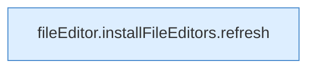

[[00 Start]] › [[Dashboard-UI]] › [[UI-Workflows]] › [[PlayerWorkflow]] › [[PlayerWorkflow.PlayerWorkflow]] › [[PlayerWorkflow.PlayerWorkflow.Teil2.Calls162]]

# PlayerWorkflow.PlayerWorkflow.Teil2.Calls162



```knoten
fileEditor.installFileEditors.refresh
  Die [[Glossar#Bedienseite|Bedienseite]] lädt neu das. Lädt neu `refresh`. Ruft `editorFor`.
```

> [!knoten]- Was die Blöcke tun
> - **fileEditor.installFileEditors.refresh**: Die [[Glossar#Bedienseite|Bedienseite]] lädt neu das. Lädt neu `refresh`. Ruft `editorFor`.

- Weitere [[Glossar#Funktion|Funktionen]], die ab [[Glossar#Zeile|Zeile]] 162 aufgerufen werden.
- Fortsetzung von `PlayerWorkflow.PlayerWorkflow.Teil2`.
