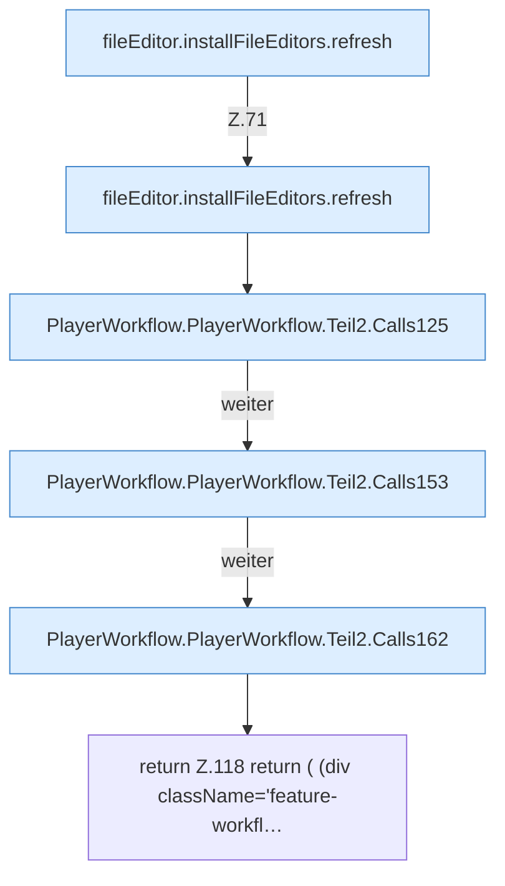

[[00 Start]] › [[Dashboard-UI]] › [[UI-Workflows]] › [[PlayerWorkflow]] › [[PlayerWorkflow.PlayerWorkflow]] › [[PlayerWorkflow.PlayerWorkflow.Teil2]]

# PlayerWorkflow.PlayerWorkflow.Teil2



```knoten
fileEditor.installFileEditors.refresh
  Die [[Glossar#Bedienseite|Bedienseite]] lädt neu das. Lädt neu `refresh`. Ruft `editorFor`.
PlayerWorkflow.PlayerWorkflow.Teil2.Calls125
  Weitere [[Glossar#Funktion|Funktionen]], die ab [[Glossar#Zeile|Zeile]] 125 aufgerufen werden. Weitere eigene Aufrufe ab Zeile 125.
PlayerWorkflow.PlayerWorkflow.Teil2.Calls153
  Weitere [[Glossar#Funktion|Funktionen]], die ab [[Glossar#Zeile|Zeile]] 153 aufgerufen werden. Weitere eigene Aufrufe ab Zeile 153.
PlayerWorkflow.PlayerWorkflow.Teil2.Calls162
  Weitere [[Glossar#Funktion|Funktionen]], die ab [[Glossar#Zeile|Zeile]] 162 aufgerufen werden. Weitere eigene Aufrufe ab Zeile 162.
return Z.118 return ( (div className='feature-workfl…
  Zeile 118: Rückgabe `return ( (div className='feature-workfl…`.
```

> [!knoten]- Was die Blöcke tun
> - **fileEditor.installFileEditors.refresh**: Die [[Glossar#Bedienseite|Bedienseite]] lädt neu das. Lädt neu `refresh`. Ruft `editorFor`.
> - **PlayerWorkflow.PlayerWorkflow.Teil2.Calls125**: Weitere [[Glossar#Funktion|Funktionen]], die ab [[Glossar#Zeile|Zeile]] 125 aufgerufen werden. Weitere eigene Aufrufe ab Zeile 125.
> - **PlayerWorkflow.PlayerWorkflow.Teil2.Calls153**: Weitere [[Glossar#Funktion|Funktionen]], die ab [[Glossar#Zeile|Zeile]] 153 aufgerufen werden. Weitere eigene Aufrufe ab Zeile 153.
> - **PlayerWorkflow.PlayerWorkflow.Teil2.Calls162**: Weitere [[Glossar#Funktion|Funktionen]], die ab [[Glossar#Zeile|Zeile]] 162 aufgerufen werden. Weitere eigene Aufrufe ab Zeile 162.
> - **return Z.118 return ( (div className='feature-workfl…**: Zeile 118: Rückgabe `return ( (div className='feature-workfl…`.

- Ein weiterer Abschnitt derselben Übersicht.
- Fortsetzung von `PlayerWorkflow.PlayerWorkflow`.
