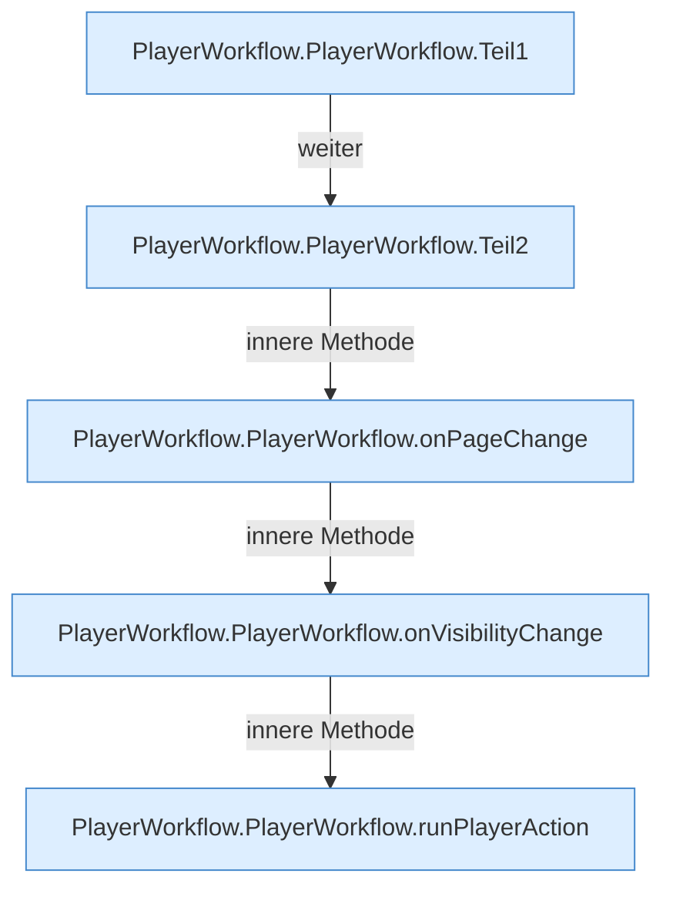

[[00 Start]] › [[Dashboard-UI]] › [[UI-Workflows]] › [[PlayerWorkflow]] › [[PlayerWorkflow.PlayerWorkflow]]

# PlayerWorkflow.PlayerWorkflow

`PlayerWorkflow.PlayerWorkflow()` [ui/src/components/PlayerWorkflow.tsx:20–203](https://github.com/Sciddie/minecraft-serverhoster-plugin/blob/95b02b953b0b4c23673e900e021a7c3c844aa37d/ui/src/components/PlayerWorkflow.tsx#L20-L203)



```knoten
PlayerWorkflow.PlayerWorkflow.Teil1
  Abschnitt 1 dieses Ablaufs, in Quellreihenfolge.
PlayerWorkflow.PlayerWorkflow.Teil2
  Abschnitt 2 dieses Ablaufs, in Quellreihenfolge.
PlayerWorkflow.PlayerWorkflow.onPageChange
  Reagiert `onPageChange`. Ruft `refresh`.
PlayerWorkflow.PlayerWorkflow.onVisibilityChange
  Reagiert `onVisibilityChange`. Ruft `refresh`.
PlayerWorkflow.PlayerWorkflow.runPlayerAction
  Führt aus `runPlayerAction`. Ruft `sendCommand`, `refresh`.
```

- `PlayerWorkflow` in `ui/src/components/PlayerWorkflow.tsx`
