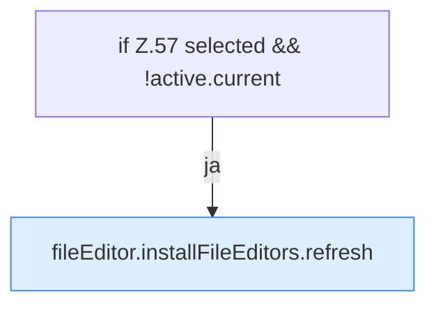

[[00 Start]] › [[Dashboard-UI]] › [[UI-Workflows]] › [[PlayerWorkflow]] › [[PlayerWorkflow.PlayerWorkflow]] › [[PlayerWorkflow.PlayerWorkflow.onPageChange]]

# PlayerWorkflow.PlayerWorkflow.onPageChange

`PlayerWorkflow.onPageChange(event: Event)` [ui/src/components/PlayerWorkflow.tsx:55–59](https://github.com/Sciddie/minecraft-serverhoster-plugin/blob/95b02b953b0b4c23673e900e021a7c3c844aa37d/ui/src/components/PlayerWorkflow.tsx#L55-L59)



```knoten
if Z.57 selected && !active.current
  Zeile 57: prüft `selected && !active.current`.
fileEditor.installFileEditors.refresh
  Die [[Glossar#Bedienseite|Bedienseite]] lädt neu das. Lädt neu `refresh`. Ruft `editorFor`.
```

> [!knoten]- Was die Blöcke tun
> - **if Z.57 selected && !active.current**: Zeile 57: prüft `selected && !active.current`.
> - **fileEditor.installFileEditors.refresh**: Die [[Glossar#Bedienseite|Bedienseite]] lädt neu das. Lädt neu `refresh`. Ruft `editorFor`.

- Die [[Glossar#Bedienseite|Bedienseite]] macht hier einen einzelnen Schritt. Eine Ebene tiefer steht er genauer.
- `onPageChange` in `ui/src/components/PlayerWorkflow.tsx`
