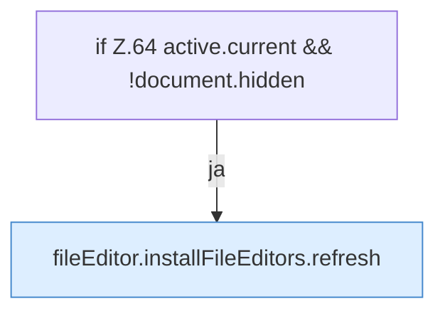

[[00 Start]] › [[Dashboard-UI]] › [[UI-Workflows]] › [[PlayerWorkflow]] › [[PlayerWorkflow.PlayerWorkflow]] › [[PlayerWorkflow.PlayerWorkflow.onVisibilityChange]]

# PlayerWorkflow.PlayerWorkflow.onVisibilityChange

`PlayerWorkflow.onVisibilityChange()` [ui/src/components/PlayerWorkflow.tsx:63–65](https://github.com/Sciddie/minecraft-serverhoster-plugin/blob/95b02b953b0b4c23673e900e021a7c3c844aa37d/ui/src/components/PlayerWorkflow.tsx#L63-L65)



```knoten
if Z.64 active.current && !document.hidden
  Zeile 64: prüft `active.current && !document.hidden`.
fileEditor.installFileEditors.refresh
  Lädt neu `refresh`. Ruft `editorFor`.
```

- `onVisibilityChange` in `ui/src/components/PlayerWorkflow.tsx`
