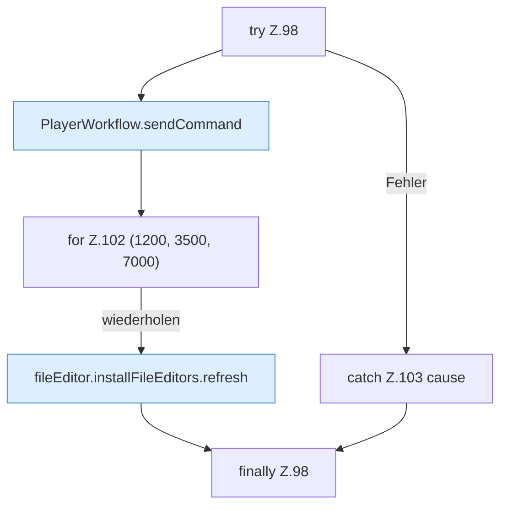

[[00 Start]] › [[Dashboard-UI]] › [[UI-Workflows]] › [[PlayerWorkflow]] › [[PlayerWorkflow.PlayerWorkflow]] › [[PlayerWorkflow.PlayerWorkflow.runPlayerAction]] › [[PlayerWorkflow.PlayerWorkflow.runPlayerAction.Z98]]

# PlayerWorkflow.PlayerWorkflow.runPlayerAction.Z98

- Fortsetzung von `PlayerWorkflow.PlayerWorkflow.runPlayerAction`, Quellreihenfolge.
