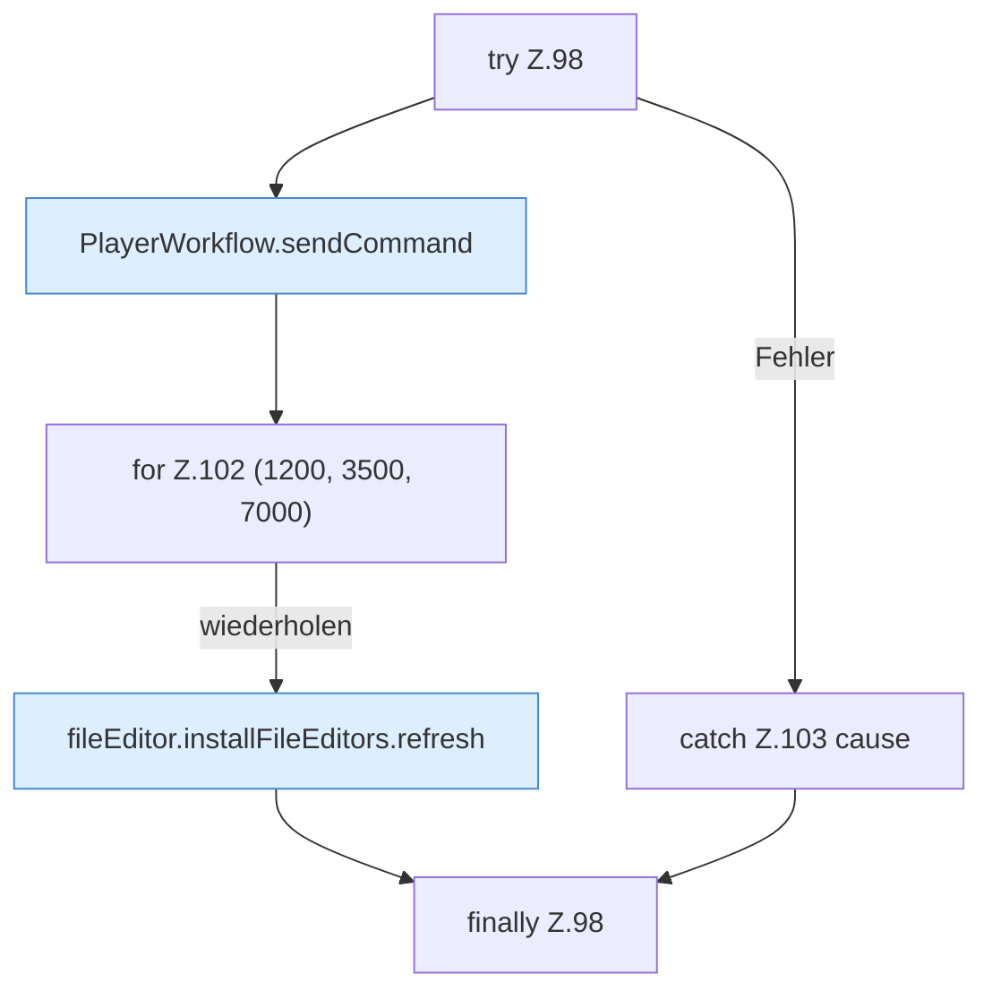

[[00 Start]] › [[Dashboard-UI]] › [[UI-Workflows]] › [[PlayerWorkflow]] › [[PlayerWorkflow.PlayerWorkflow]] › [[PlayerWorkflow.PlayerWorkflow.runPlayerAction]] › [[PlayerWorkflow.PlayerWorkflow.runPlayerAction.Z98]]

# PlayerWorkflow.PlayerWorkflow.runPlayerAction.Z98



```knoten
try Z.98
  Zeile 98: Versuch. Der Fehlerpfad geht in catch.
PlayerWorkflow.sendCommand
  Die [[Glossar#Bedienseite|Bedienseite]] schickt den [[Glossar#Befehl|Befehl]]. Sendet `sendCommand`. Ruft `dashboardRequest`, `jsonBody`.
for Z.102 (1200, 3500, 7000)
  Zeile 102: Schleife `(1200, 3500, 7000)`.
fileEditor.installFileEditors.refresh
  Die [[Glossar#Bedienseite|Bedienseite]] lädt neu das. Lädt neu `refresh`. Ruft `editorFor`.
catch Z.103 cause
  Zeile 103: fängt cause.
finally Z.98
  Läuft danach immer, auch nach einem Fehler.
```

> [!knoten]- Was die Blöcke tun
> - **try Z.98**: Zeile 98: Versuch. Der Fehlerpfad geht in catch.
> - **PlayerWorkflow.sendCommand**: Die [[Glossar#Bedienseite|Bedienseite]] schickt den [[Glossar#Befehl|Befehl]]. Sendet `sendCommand`. Ruft `dashboardRequest`, `jsonBody`.
> - **for Z.102 (1200, 3500, 7000)**: Zeile 102: Schleife `(1200, 3500, 7000)`.
> - **fileEditor.installFileEditors.refresh**: Die [[Glossar#Bedienseite|Bedienseite]] lädt neu das. Lädt neu `refresh`. Ruft `editorFor`.
> - **catch Z.103 cause**: Zeile 103: fängt cause.
> - **finally Z.98**: Läuft danach immer, auch nach einem Fehler.

- Der Ablauf geht in [[Glossar#Zeile|Zeile]] 98 weiter. Eine Ebene tiefer steht er genauer.
- Fortsetzung von `PlayerWorkflow.PlayerWorkflow.runPlayerAction`.
