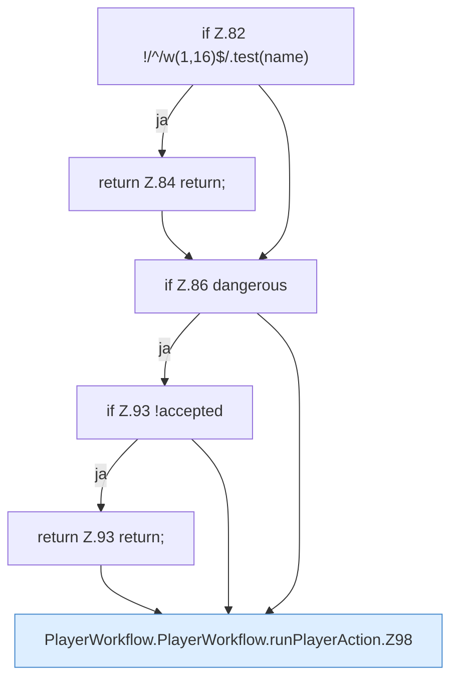

[[00 Start]] › [[Dashboard-UI]] › [[UI-Workflows]] › [[PlayerWorkflow]] › [[PlayerWorkflow.PlayerWorkflow]] › [[PlayerWorkflow.PlayerWorkflow.runPlayerAction]]

# PlayerWorkflow.PlayerWorkflow.runPlayerAction

`PlayerWorkflow.runPlayerAction(action: string, dangerous = false)` [ui/src/components/PlayerWorkflow.tsx:80–108](https://github.com/Sciddie/minecraft-serverhoster-plugin/blob/95b02b953b0b4c23673e900e021a7c3c844aa37d/ui/src/components/PlayerWorkflow.tsx#L80-L108)



```knoten
if Z.82 !/^/w(1,16)$/.test(name)
  Zeile 82: prüft `!/^/w(1,16)$/.test(name)`.
return Z.84 return;
  Zeile 84: Rückgabe `return;`.
if Z.86 dangerous
  Zeile 86: prüft `dangerous`.
if Z.93 !accepted
  Zeile 93: prüft `!accepted`.
return Z.93 return;
  Zeile 93: Rückgabe `return;`.
PlayerWorkflow.PlayerWorkflow.runPlayerAction.Z98
  Fortsetzung des Ablaufs ab Zeile 98.
```

- `runPlayerAction` in `ui/src/components/PlayerWorkflow.tsx`
